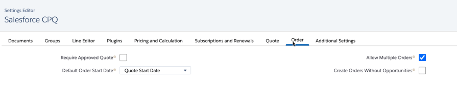

Suppose you have been working on setting up Advanced Approvals. In that case, you may have run into a scenario where you need to aggregate some data from a related object to the object you are running the Approvals on to satisfy an Approval Condition.

For example, your Sales leadership cares about the sum of the Total Price field on the Opportunity Products or the sum of a quantity for a particular Product Family; rather than dealing with rollup fields and running up your field count, you can use Approval Variables to do the extrapolation of the data for you on the fly during the Approval process.

To set an Approval Variable, simply go to the object and then click New and fill out the fields.

<figure>

<figcaption>

This Approval Variable sums the Total Price across all of the Opportunity Products on an Opportunity

</figcaption>

</figure>

Here are what each of the fields mean:

1. Variable Name - Give this Approval Variable an understandable name so you can easily reference it later
2. Target Object - this is likely going to be a related/child object of the object that your Approval Chain and Approval Rules are targeting
3. Aggregate Field - this field is populated when you are looking to do a summarization (Sum,Max, Min, etc.) of a field on the Target object
4. Aggregate Function - this field is where you indicate what you want to do with the field noted in #3
5. Filter Field - this is used if you want to only look at certain child records, for example filter based on Product Family
6. Filter Value - this is used in conjunction with #5 so that you can set the value you want to filter, i.e. Software
7. Operator - this works in conjunction with #5 and #6 to determine if you want the field to contain or not contain, or be equal to, etc to the value you put in #6
8. Combine With - perhaps you have another Approval Variable that you want to this to combine with, in order for them work in tangent for the Tested or Filter Variable in the Approval Condition
9. List Variable - required when you are selecting Type = Discount and is a reference to another Approval Variable that does a summary of the Total Price
10. Net Variable - required when you are selecting Type = Discount and is a reference to another Approval Variable that does a summary of the Net Price
11. Type - you have the option of making this Approval Variable either a Summary or Discount type. Summary uses the aggregate fields, while Discount uses the List and Net variables to apply an equation (((1-(Net Variable/List Variable))\*100)

There you have it, the fields and their requirements for setup for creating an Approval Variable. Always keep Approval and [Summary Variables (CPQ)](https://sf9to5.wordpress.com/2017/08/17/create-alert-cpq/) in mind to determine if that rollup field is essential.
