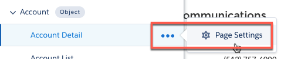
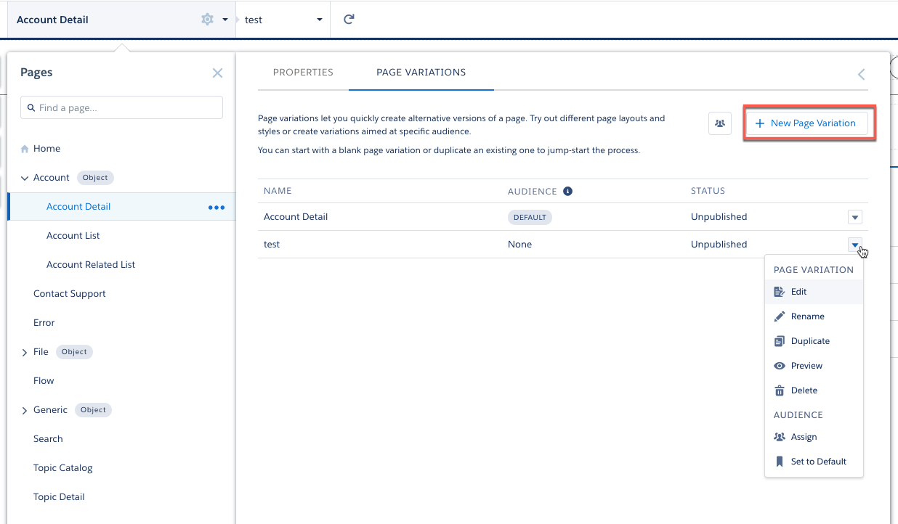
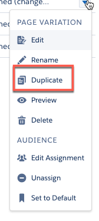
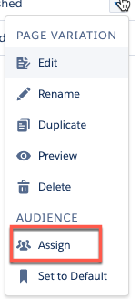
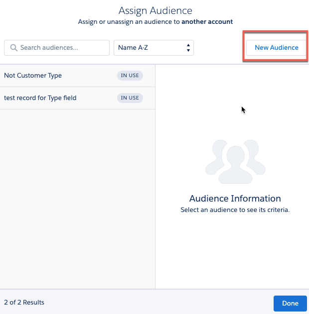
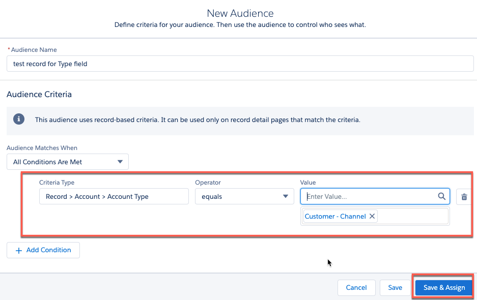
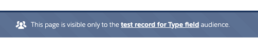

A while ago, Salesforce introduced Audiences as a mechanism to help make the community experience more dynamic based on different factors that the user had - for example, their location or details from a specific field in their user record. In the Winter '21 release, Salesforce expanded Audiences' capabilities and introduced the ability to use Salesforce Record detail information. This functionality is similar to the [Dynamic Forms](https://sf9to5.wordpress.com/2021/01/26/dynamic-forms-winter-21-release/) that also GA'ed in the Winter '21 release for Custom Objects. You can see the complete list of support objects here.

So let's walk through an example of setting up an Audience that is using the record detail information.

1. Go to the Experience Builder for the Community you are working on
2. Go to the Page Menu in the top left and locate a Record Detail Page
3. Click the 3 dots ellipses on the right hand side of the Record Detail Page and click Page Settings  
    
4. Click Page Variations in the top tab
5. Click New Page Variation or click the the drop down next to the page variation that you want to duplicate  
    
    1. It is important that you keep a default page and then create additional variations that will have audiences. If you do not have a default page that does not have an audience Salesforce will throw an ugly error message at you.
6. Once you have the page variation, you will be able to assign and create an Audience - do this by clicking the dropdown and click Assign  
    
7. Once on the Audience page, if you have already created some Audiences you will see them here. You can either use an existing Audience or create a new one by clicking the New Audience button in the top right  
    
8. To create an Audience that is record based, in the first column find Record, then select the Object, then select the field. From there the system will give you the available operators depending on the type of field you picked, and then you can set the value. In my example, I set the Account Type field to be equal to Customer - Channel.  
    
9. Once done, click Save and Assign, and then you will be able to see that the Page Variation at the top shows which Audience is being applied.  
    

Let me know in the comments if you would like more posts explaining the different types of Audiences available and the other aspects of them that are important to keep in mind.
