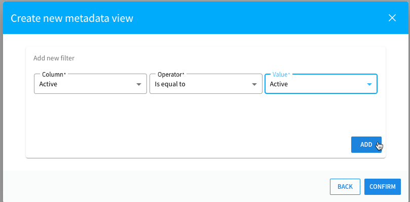
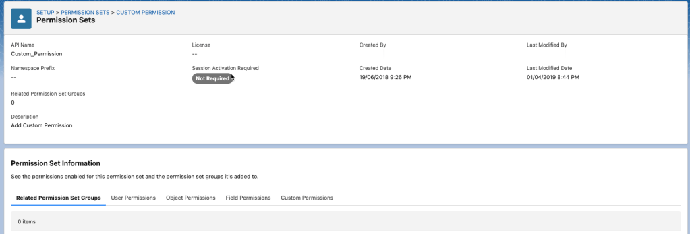
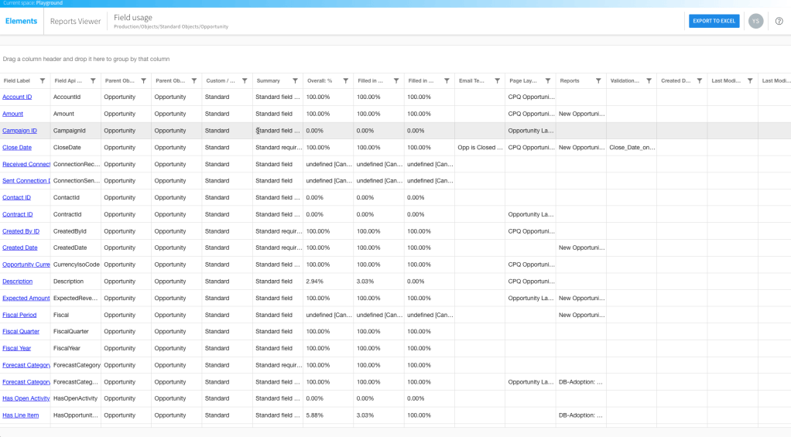

I have recently been volunteering for a Non-Profit organization to gain experience, specifically with the Non-Profit Success Pack/Cloud (NPSP) from Salesforce. Recently, one of the requests was to merge an Organization. Our initial thinking was to use the Manage Households button; however, I quickly learned that this only works for the Household Account Record Type and is specifically designed to move people around from one Household to another.

After some further digging, I realized that the merging of Organizations works the same way as it does for Lightning Sales cloud. To successfully merge Organizations, two things are required: at least one Matching Rule and one Duplicate Rule. Luckily, Salesforce provides some Matching Rules out of the box. Their information can be found [here](https://help.salesforce.com/articleView?id=sf.matching_rules_standard_rules.htm&type=5). 

Once you have a Matching Rule with the criteria you want to catch those pesky duplicates, you can create a Duplicate Rule using that Matching Rule. 

Lastly, there is one more step you will need to do, specifically in Lightning. You will need to add the Duplicate component to the Lightning Record Page - this is what will indicate on the record that you have a duplicate Organization and allow you to merge them. Below I will walk through the steps of putting all of this together.

**Creating a Matching Rule (only if the standard does not work):**

1. Pick the Object you want to match against, in this case Account (Organization is a relabel specifically for the NPSP)  
    

2. Set up the criteria that you want to match against  
    

3. Activate the Matching Rule

**Creating a Duplicate Rule**

1. Pick the Object you want the Matching Rule to run on  
    

2. Indicate if you want to just Alert, Report, or Block if a Duplicate is found  
    

3. Pick the relevant Matching Rule
4. Activate the Duplicate Rule  
    

**Updating the Lightning Record Page**

1. Go to the Lightning Record Page for the relevant Object
2. Add the Potential Duplicates Component to the page

3. See it in action  
    

Once you have it on the page and the system detects a duplicate you can use the link within the Component to do a merge of the found duplicates.

For another example of this, please check out my article on [Lead deduplication](https://sf9to5.wordpress.com/2019/12/10/find-duplicates-button-lightning/).
