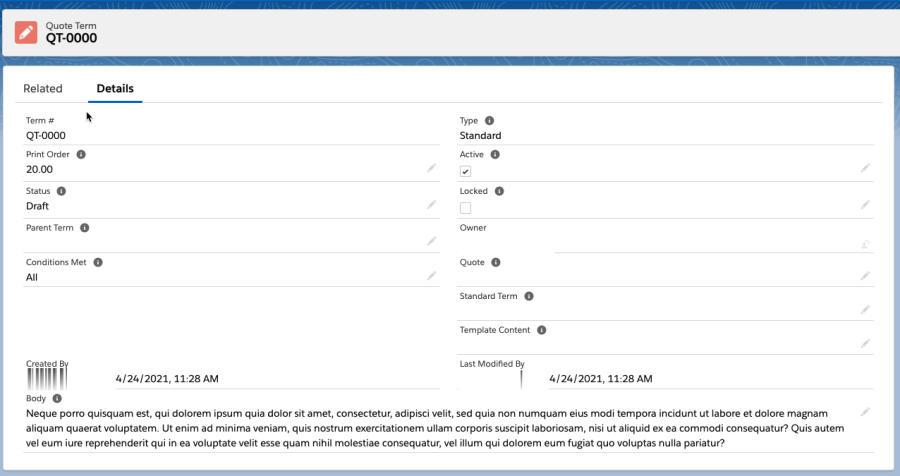
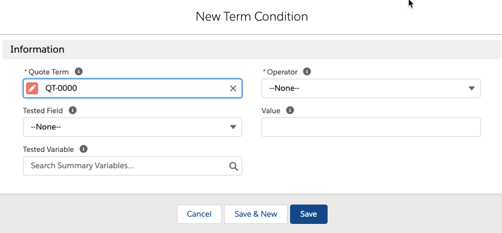
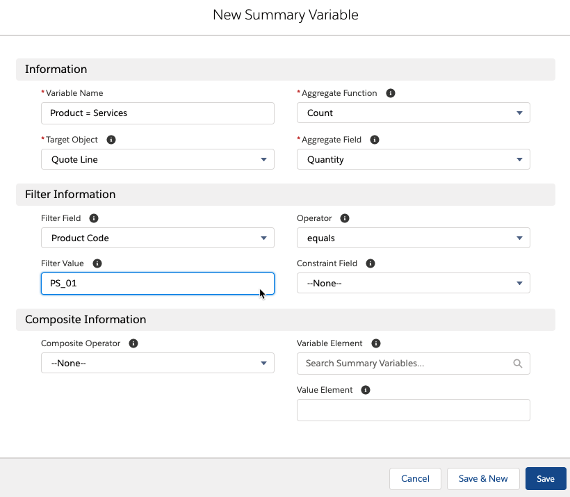

A while back, I created a post for setting up an Alert for CPQ and used a [Summary Variabl](https://sf9to5.wordpress.com/2017/08/17/create-alert-cpq/)e as part of the setup. Today, I will walk through using a Summary Variable for setting a filter on a Quote Term.

To start, the Quote Term is an object used for adding additional language to the output document, typically legal language, that is reusable from one quote to the next. For example, for every service product included on a quote, you have specific language that needs to be included in the output document. Quote Terms are used in the building of a Quote Template.

Here is a dummy example of a Quote Term:

As mentioned in my example above, you may only want this text to display if a particular product is included in the Quote. You can apply a Term Condition to the Quote Term and use a Summary Variable as part of the filter.

<figure>

<figcaption>

The Tested Field can reference any field on the Quote or Quote Template record that this Term is associated with. Alternatively, if you want to look for a Product Code, you would use a Summary Variable.

</figcaption>

</figure>

Using this combination will allow you to have multiple versions of Quote Terms, each specific to the Products included on the Quote.
