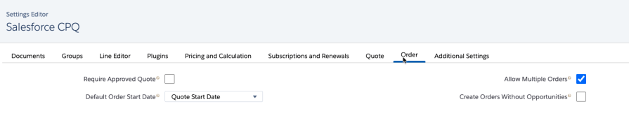
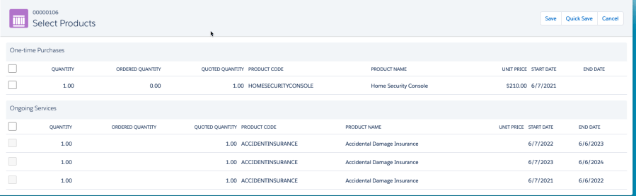
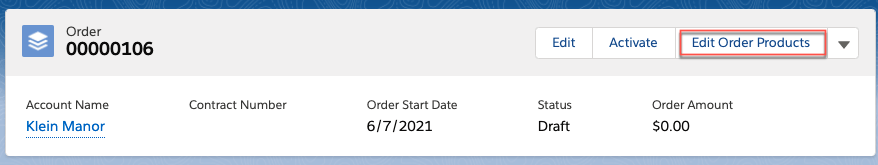
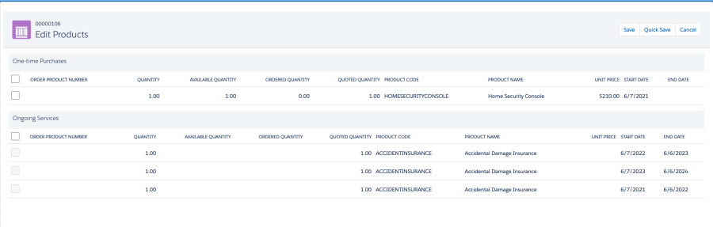

When you move from Classic experience to Lightning experience, one of the differences you may notice is the lack of the Select Products VisualForce page that you get when creating an Order and having multiple Orders per Quote enabled. _Multiple Orders per Quote is only available as part of CPQ+._

<figure>

<figcaption>

In Classic, when you created an Order from the Create Order button, it then took you to this screen to select the products:

</figcaption>

</figure>

In Lightning, when you create an Order from the Create Order button, it takes you directly to the Order. Initially, I tried to use the Edit Products button on the Related List for the Order Products, but this was clunky as the products were not limited to the related Quote. Then recently, someone from Salesforce informed that they added a button called Edit Products to the button menu for the Order object. This button gives you the same behavior as noted above, but it does take one extra click to get there.

<figure>

<figcaption>

  
The next page shows you the products to select:

</figcaption>

</figure>

