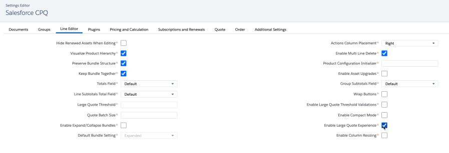
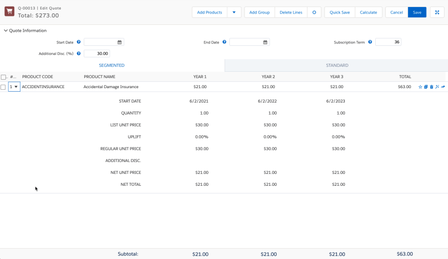

If you are experienced with using [MDQ](https://sf9to5.wordpress.com/2019/12/17/how-to-setup-mdq/), you know that sometimes it can be confusing to the Sales Rep creating the quote to understand which products are segmented vs. standard. As part of the Large Quoting Experience, Salesforce added a feature that allows you to more easily see the difference by placing the products into separate tabs on the QLE.

To enable the Large Quote Experience, go to Setup --> Installed Packages --> CPQ --> Configure --> Line Editor. Then check the box and save. Once this is turned on, it also turns on several other functionalities that are good to be aware of.

- Scroll down quote lines infinitely instead of moving between pages.
- The quote line editor shows one group at a time in the main display. Select a different group from the Groups sidebar.
- MDQ price dimensions and the segmented and standard product tables appear as tabs.
- Subtotals and summary rows are locked in place at the bottom of the quote line editor.
- Click the Expand Page icon to expand the quote line editor across your display page. Click the Escape or the Expand Page icon to return to standard view.
- Standard and segmented table headers are locked in one place at the top of the page. That way, you don’t lose your point of reference when scrolling through a list of line items.
- As of Salesforce CPQ Summer '19, users can collapse and expand bundles.

\*_Excerpt from [Large Quote Experience](https://help.salesforce.com/articleView?id=sf.cpq_large_quote_experience.htm&type=5)_

Once enabled this is what the QLE will look like when you have a combination of both MDQ products and standard products.

