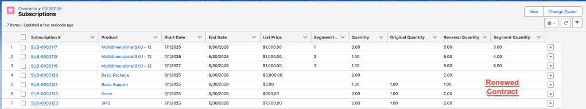
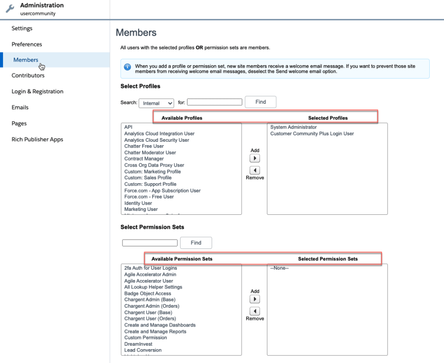

I recently worked on a Partner Portal in an environment with two other Communities, including a Customer Portal. One of the challenges I experienced during this was how to give access to the Partner to the Partner Portal and the Customer Portal. The challenge is quite easily solved with the use of a permission set or profile.

Since an external user in Salesforce cannot be both a Partner and a Customer, it is best to set the user up as a Partner User to ensure they have the Partner Community License, which has greater access than the Customer Community Licenses. Check out the information about Licenses [here](https://help.salesforce.com/articleView?id=users_license_types_communities.htm&type=0).

Once you have your user created with the correct role, profile, and license, we can look at how to ensure that they can have access to another portal.

To control access to the membership via profile or permission set, you need to do the following steps:

1. Go to Setup --> Experiences --> Workspace for the relevant community
2. Go to the Administration tile  
    

3. Go to Members
4. On the Members page, you will see the ability to select both profiles and permission sets to include for granting access to the site  
    

Depending on your scenario, if all users with a specific profile should have access to more than one Portal, then include that profile in the profile section for Members for all relevant communities. On the other hand, if only particular users need access to additional communities, create a permission set, assign that permission set to those users, and include it in the Members page for all relevant communities.

Just like that, you can grant a user access to both a Partner Portal and a Customer Portal.
