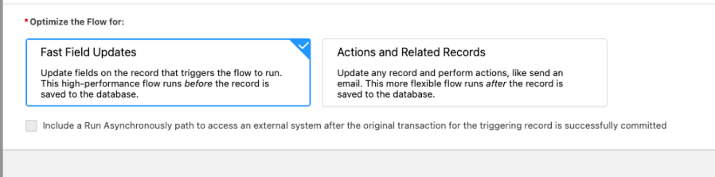
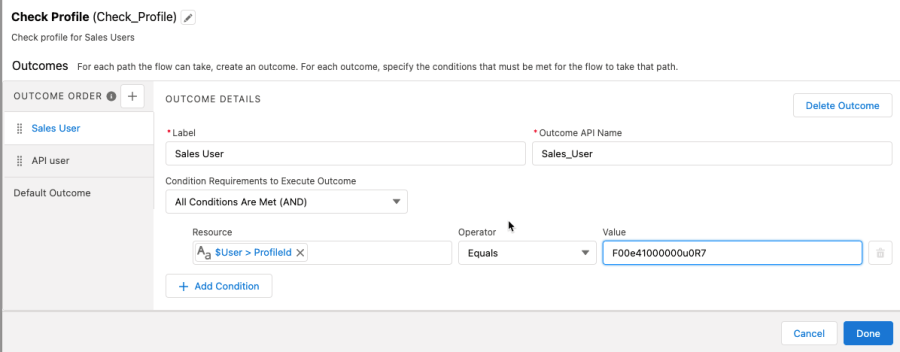
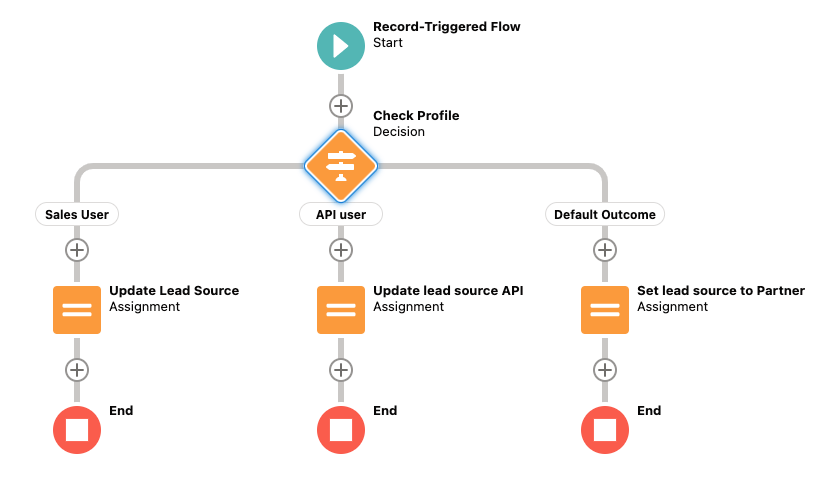

I am trying to venture down the road of understanding the in's and out's of Flows. I tried this a couple of years ago; I could not come to terms with them - coding was easier. However, with the announcement of the retirement of Workflow Rules and Process Builders and the immense number of updates and changes that Salesforce has made to the Flow process, I have decided once again to try.

I am planning on taking you on this journey with me. Some of the upcoming posts might be short, but I want to document all of the things I learn along the way, hoping that this might help you too.

In this post, I will give a made-up scenario I made for myself and the pitfalls I found myself in until I had a developer friend help me out of my pickle.

## Scenario

For every contact that is created in Salesforce, set the lead status based on who created the lead.

Sales Profile: Set to Phone Inquiry

API Integration Profile: Set to Other

Otherwise set to Partner Referral

## Some History and Solution

I started this flow back in Jan 2021, and at that time, I could not run Debug, and the options of selecting Fast Field Updates or Actions and Related Records did not exist. So I had essentially given up.

I had since learned that when I created this flow initially, I did not use the correct combination of items for either doing it as a Before Trigger or an After Trigger (those were my options back then).

I originally had it set up to look at the owner's profile while also having it set a Before Trigger, now called Fast Field Updates. While conceptually that was in line with my requirements, it does not work with a Before action since the owner field isn't set yet or saved (hence it being BEFORE). So to make this flow work, I instead needed to use the profile of the User that was firing the creation of the contact object - this you have access to during a Before process.

Alternatively, I could have done this with an After Trigger, otherwise called Actions and Related Records. However, doing so would have required an extra node, which would be an Update Record node, after the record was created. In this case, this would have been unnecessary, and the Fast Field Updates is the better choice.

Here is a visual of the Flow itself:

If you have questions about any particular node let me know in the comments down below!
