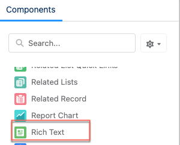
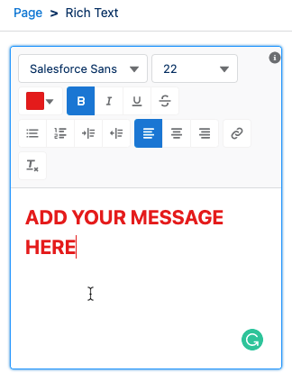
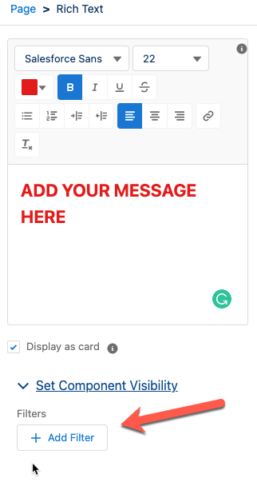
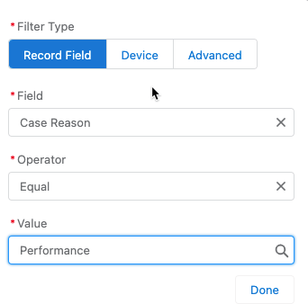
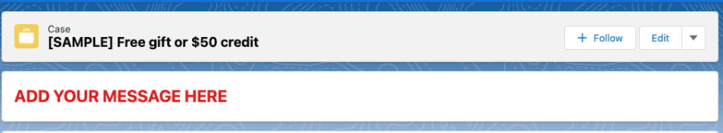

The requirement is to display a warning message on the top of a record. The message should only display if the record contains certain information. In the days of old, and by the I mean Classic, Visualforce was usually required to make a nice banner that sat on the page and could be dynamic. Today, in Lightning, code is no longer needed to complete such a task, as you can do it entirely with components and filters.

1. On the relevant Lightning Record page, add the Rich Text component  
    

2\. On the right-hand side fill in the Rich Text Editor with the message you want to display  

3\. Underneath the message section, you can set up the component filter. For example, I am setting it up to display based on Case Reason.  

4\. After you have finished setting that up, save the page, and make sure it is Activated. Then go test it out!  

