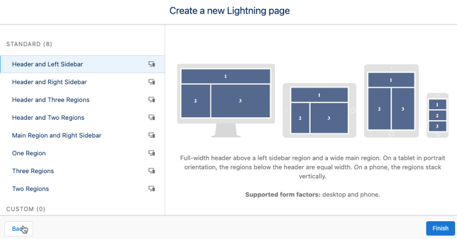

First up is Page Layouts; Out of the three, this is the one you should already be familiar with. You get to this layout by going to the Object in Setup and then clicking Page Layout. Once there, it will look identical to what you are used to seeing in Classic, and that would be because this is the same layout from Classic.

So somewhat in a Russian Doll style, the Page Layout is displayed inside of the Record Page. Without any creation on your part, when Lightning opens up for the first time, it shows a default Record Page. This is the view you see when you click on any object and go to a record. The first time you go to edit that view, you will get the opportunity to save your Record Page.

Similar to Page Layouts, you can have multiple Record Pages, perhaps based on Profiles or Record Types. The Record Page is the home to all of the different components that live on the page.

A component is what it sounds like. It is a building block, item, or widget that lives on the page, and depending on how you structure the page, you can have as many or as few as you need. 

Remembering the difference between the Record Page and the Page Layout will help you in the future when you need to make edits. In addition, you can easily access the Record Page directly from the page you are on by going to the Gear icon and clicking Edit Page.

A Lightning Page is very similar to creating a VisualForce Tab in Classic. It's the idea of creating a completely custom page made up of components that show what you want, not specific to a record or object type. These are great if you're going to create a tab for your users to access and make a customized selection of items for them to view in a single space - fewer clicks all the way! To create a Lightning Page, you would use the Lightning App Builder. Do not confuse it with the App Manager, which is the same thing in Classic - where you manage the Apps.

