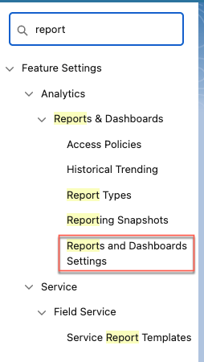
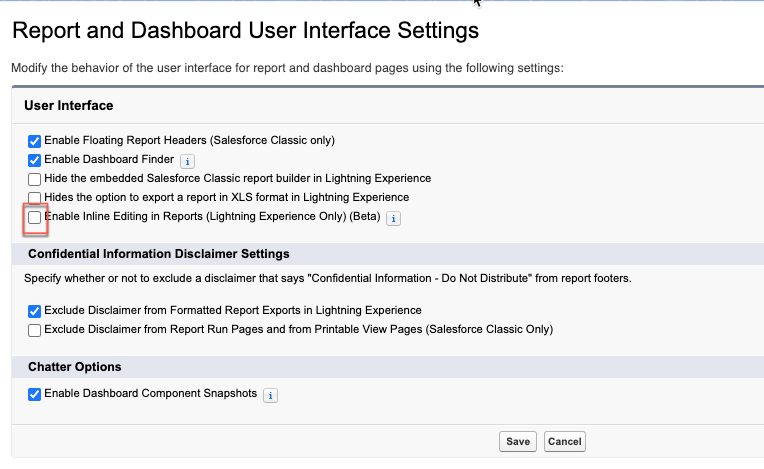
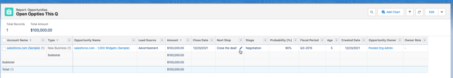
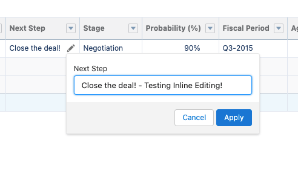
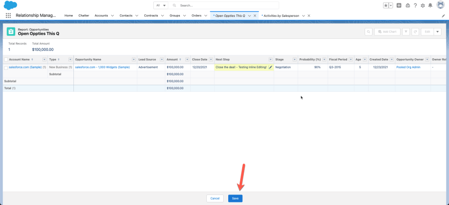

Finally! One of the things I have been asked for the most since I first took a job as a Salesforce Admin was the ability to edit inline a report. Well, our wishes have come true. In the Spring '22 release, this feature is in Beta and available to use.

To use this, first, go to Setup --> Reports and Dashboards Settings  

Enable Inline Editing for your org  

Now go to a report with fields on that you can edit.

Look for the pencil icon, similar to how you would edit in a list view, click it, and away you go!

Don't forget to click the save button at the bottom after applying your changes.

Please keep in mind that not only is this in Beta, but there is a list of fields [Salesforce](https://help.salesforce.com/s/articleView?id=release-notes.rn_rd_reports_inline_editing.htm&type=5&release=232) currently does not support inline editing on:

Inline editing isn’t supported for these fields and field types.

- Task and event object fields
- System fields such as Record ID and Created Date
- Compound fields, including name and address fields
- Picklists
- Custom date/time fields
- Encrypted text fields
- Formula fields
- Standard fields of type date/time, auto number, rollup summary, record type, master-detail, long text area, rich text, or hierarchy
- Other fields where editing isn’t permitted due to restrictions in the page layout or record type
