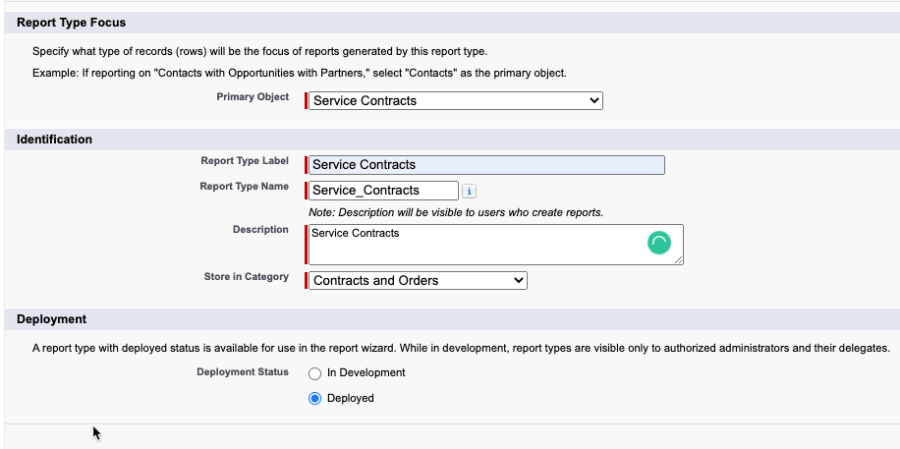
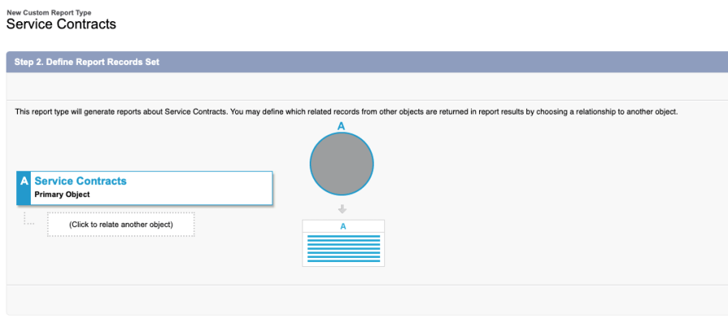
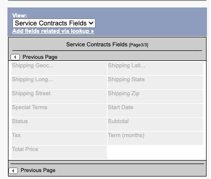
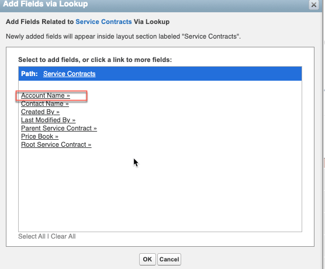
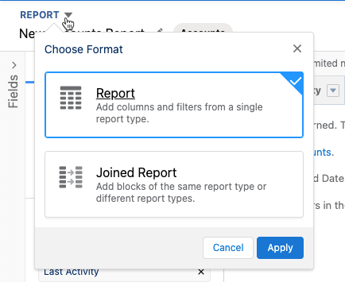
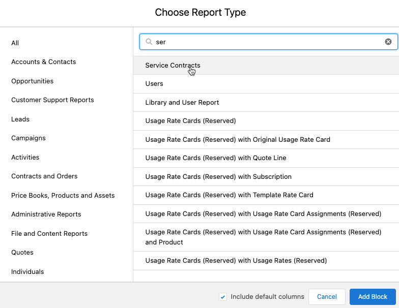
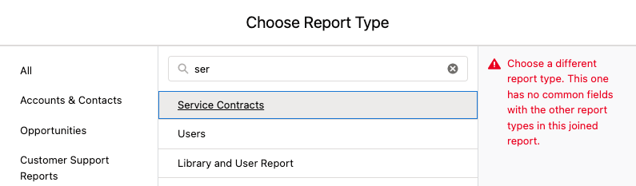
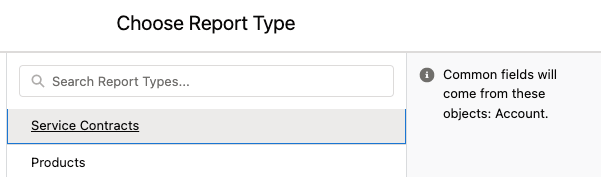
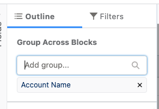
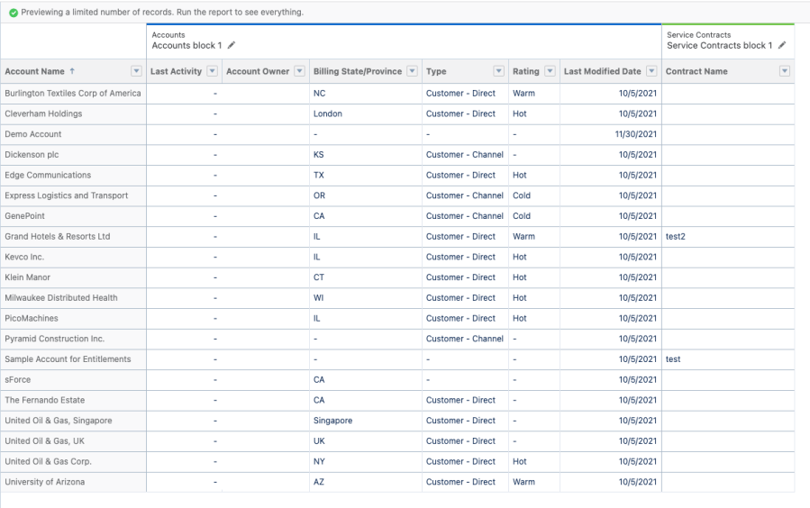

This tutorial will walk you through how to create a report that meets the requirement of Accounts with Service Contracts. The goal is not to add any fields and to start from the Account object. Unfortunately, Salesforce does not support Accounts and Service Contracts together for a custom Report Type as of the day of writing, so we will use a joined report to get the same effect.

1. Go to Setup --> Report Types --> Create new Custom Report Type
2. Set the Primary Object to be Service Contract and fill out the rest as you want  
    

3. You do not need to select any additional related objects on the next screen  
    

4. Go to the layout, and the on the right select add from Lookup Field  
    

5. You are going to want to add pretty much any Account field that are you going to want to use, also make sure to include Account Name and ID, otherwise you can end up with an error message later in the process  
    

6. Go to reports, create a new report and select Accounts type
7. Change the type of report to a Joined Report  
    

8. Add a block, and look for the Service Contract report  
    

9. If you did not bring in overlapping fields (I brought in all of the Account fields), you would get this error - keep adding account fields until this goes away  
    

10. Once you have added the block, you can update your filters and set your columns
11. Make sure to Group by Account Name, otherwise it will look like the Contracts belong to a different account  
     

Final Result:

If you do not need to do Accounts with and without Service Contracts, you can use the new Report Type you made and do Service Contracts with and without Accounts in a normal report using filters.
