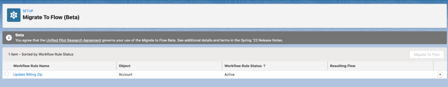
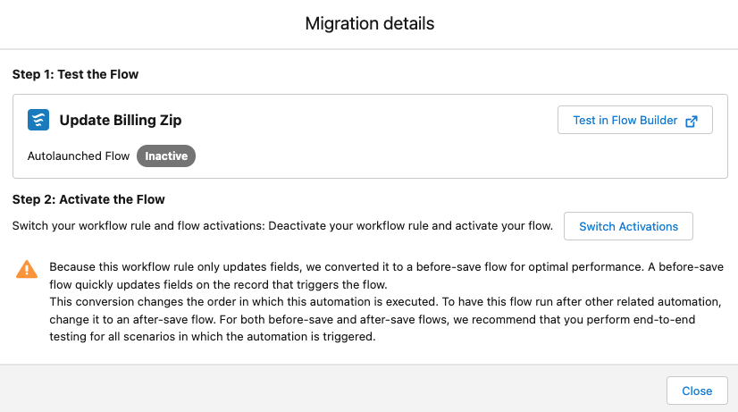
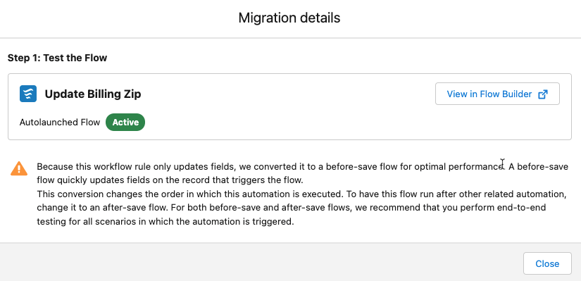
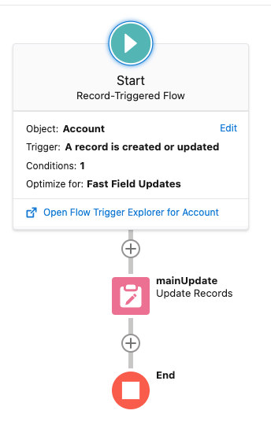

_At the time of writing this article, two important factors to note:_

1. _This is in Beta - so please read the details and terms provided in the [release notes](https://help.salesforce.com/s/articleView?id=release-notes.rn_automate_flow_mgmt_migrate_to_flow_tool.htm&type=5&release=236)_
2. _This is ONLY working for Workflow Rules, not Process Builders_

With the upcoming retirement of Workflow Rules and Process Builders, Salesforce is giving us the tools we need to convert to Flows. In the Spring '22 release, we are getting the beta version of the Migrate to Flow tool, which allows you to take a Workflow Rule and automatically convert it to a Flow.

I tested this out in a pre-release sandbox with a basic workflow rule; I hope to test more complex ones in the future when I have access beyond an empty sandbox.

Below are the steps for migrating:

1\. Either through Setup --> Migrate to Flow or by going to Setup --> Workflow Rules, you can access the Migration steps

<figure>

<figcaption>

From the Workflow Rule directly

</figcaption>

</figure>

<figure>

<figcaption>

Via Setup --> Migrate to Flow

</figcaption>

</figure>

2\. Select the Workflow you want to Migrate and then click Migrate to Flow (see screenshot above)

3\. You will then be displayed a screen with some information about the conversion

4\. Click Switch Activations if you want to test it out, or go straight to the Flow Builder to run a debug test; Note that at the bottom, it gives you some information about the conversion that happened, including a decision about the before/after timing of the flow.

<figure>

<figcaption>

What you see if you Switch Activations

</figcaption>

</figure>

5\. Go check your flow out!

