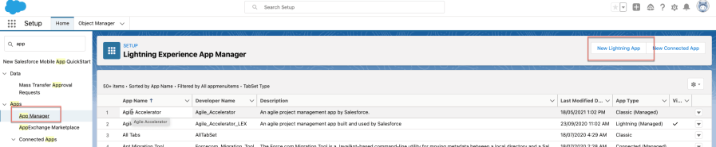
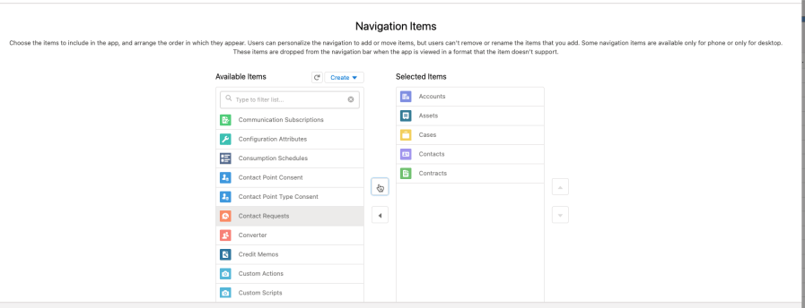
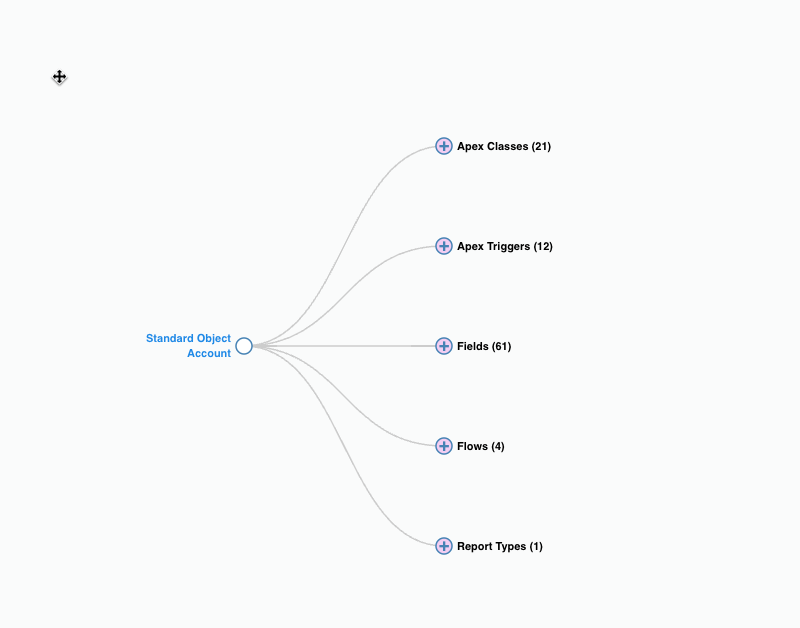
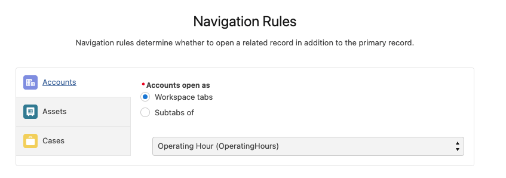
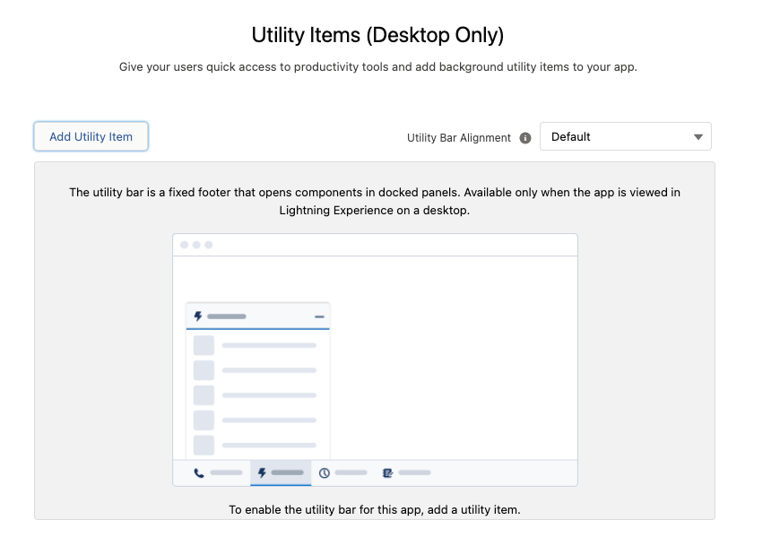
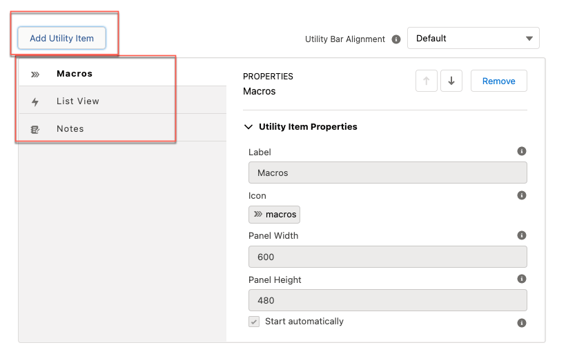
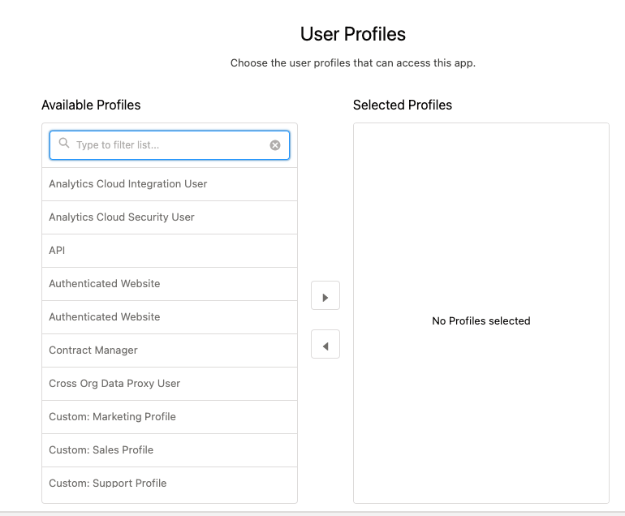

Lightning Apps in Salesforce are a great tool to have at your disposal for giving your users a streamlined view of the things they need at their fingertips.

As a quick reminder on how to create a Lightning App go to: Setup --> App Manager --> New Lightning App

Here are all of the things you can control using a Lightning App:

1\. Have the App present the user only a subset of tabs (you can choose when building the app if they can modify them or not)

<figure>

<figcaption>

Decide if the user can modify or not

</figcaption>

</figure>

<figure>

<figcaption>

Select which Tabs should appear in the app

</figcaption>

</figure>

<figure>

<figcaption>

Check out your App and see the Tabs in action

</figcaption>

</figure>

2\. Define the type of navigation you want - console or standard. If you choose a console, you would get an extra step during setup for how you want tabs to behave - either as workspace tabs or subtabs of another object.

<figure>

<figcaption>

Defining the navigation style

</figcaption>

</figure>

3\. Define if the app is for Phone, Desktop, or both (form factor)

4\. Determine if you want a footer bar (Utility bar) and what you want on it

5\. Control which profiles or permission sets have access to the App

<figure>

<figcaption>

Profiles can be selected during setup

</figcaption>

</figure>

To update a permission set, go to the permission set --> Assigned Apps --> select or remove the apps you want to be included
