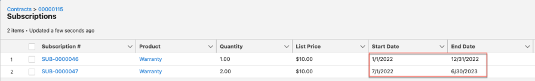
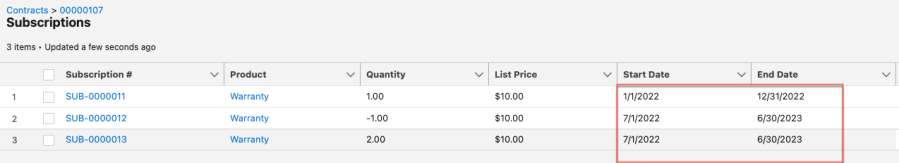
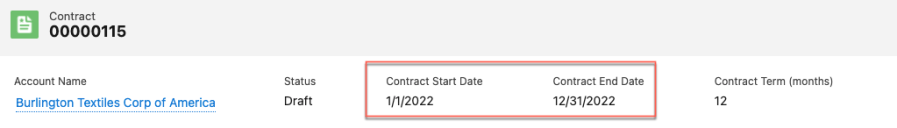
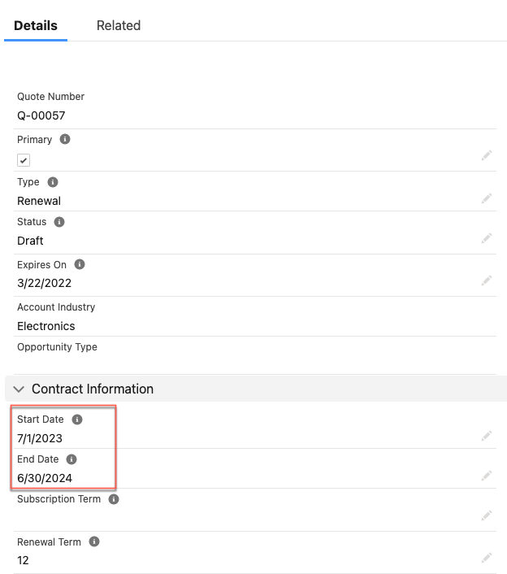
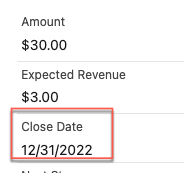
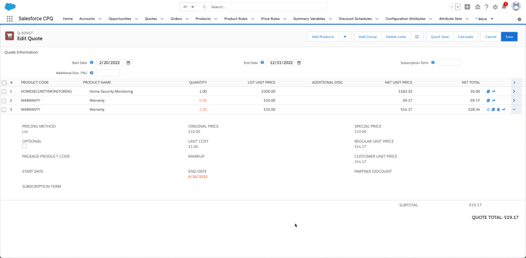
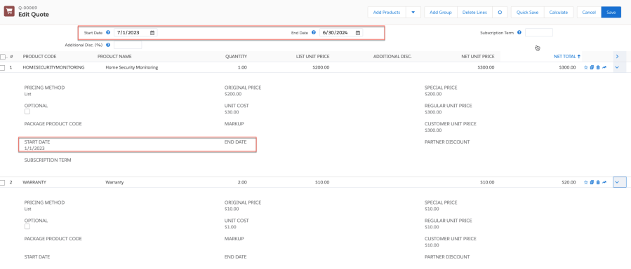

You likely landed on this article because you are trying to update Products via an Amendment in CPQ while also adding term length to that Contract. I will preface that while CPQ supports this process in some ways, it is not fully supported for all scenarios.

First and foremost, let's get some logistics out of the way. For any of this process to work, you need to make sure you have the following settings:

1. _Preserve Bundle Structure on all of your accounts is set to TRUE_
2. _You are doing this a Contract Based Model, not an Asset Based Model_

Ok, so let's talk about a couple of different scenarios and the best way to approach them.

****Scenario 1** -** Simple quote with a subscription product(s) for 12 months, and you want to increase the quantity and increase the term to 18 months (or an extra six months from the original end date) for all products. This is not a scenario where the customer wants to treat the deal as ultimately net new, or if you need to extend time - that would be a Rip and Replace or an Early Renewal - I will have articles on these topics out soon.

There are two ways to handle this:

1. If you do not need to adjust pricing, you can adjust the Start Date and End Date of the Quote to be what you need it to be, as well as the Quantity.
2. If you do need to adjust pricing, you will need to zero out the existing line, which will give you credit for the cost, and then add the product back, adjusting the Quantity and Price. Then you will need to update the End Date to the net new End Date.

The caveat to both options above has to do with the Contract's End Date vs. the End Date of the Subscription. The Contract's End Date will never change, but the Subscription will have the correct End Date.

<figure>

<figcaption>

Subscription Dates for the first option

</figcaption>

</figure>

<figure>

<figcaption>

Subscription Dates for the second option

</figcaption>

</figure>

<figure>

<figcaption>

Contract Dates

</figcaption>

</figure>

Depending on how you have defined the Amendment and Renewal Behavior field will drive the results on the Renewal.

From Salesforce (applied to both Amendments and Renewals):

- Latest End Date: Amendment quotes on this contract set their end dates to the latest end date among all the contract subscriptions.
- Earliest End Date: Amendment quotes on this contract set their end dates to the earliest end date among all the contract subscriptions.

So in my scenario above, for either option, since I had it set to the Latest End Date, it set my Renewal Opp to Close at the original End Date, but the Quote to be based on the Lastest Subscription End Date.

<figure>

<figcaption>

Renewal Quote Dates

</figcaption>

</figure>

<figure>

<figcaption>

Renewal Opp Close Date

</figcaption>

</figure>

**Scenario 2** - A complex quoting situation where you have more than one Subscription Product, but you don't want to extend everything on the Quote.

In this scenario, you will need to ensure that you have the End Date available either on Groups or on the Quote Line, as the rep will have to modify this information there. You will also need to instruct the user to either: churn the line completely and add a net new line or, just add a net new line. The difference may come down to how your bundles are structured.

<figure>

<figcaption>

Amendment Quote

</figcaption>

</figure>

Upon Renewal, the Quote will reflect the Lastest End Date + 1, as indicated by the field on the Contract. However, the Quote lines that were not updated during the amendment process will be backdated to account for the difference in time.

<figure>

<figcaption>

Renewal Quote

</figcaption>

</figure>

Word to the wise, do not change the date fields on a Quote Line that already exists. If you do this, when you get to the Renewal, it double counts the Subscription to try and make up for what it thinks is the delta from the previous start date to the new start date.

I typically advise against Amend and Extend because as you add complexity, CPQ can do different behaviors than one might expect. In addition, it can be confusing to reps and, in general, reporting when the Subscription End Dates supersede the Contract End Date. If you feel this is an applicable situation, I would recommend only doing scenario 1, in which you change the dates for everything on the Contract, rather than pieces of it, to ensure smooth renewals.
