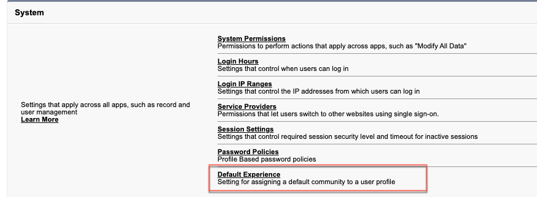
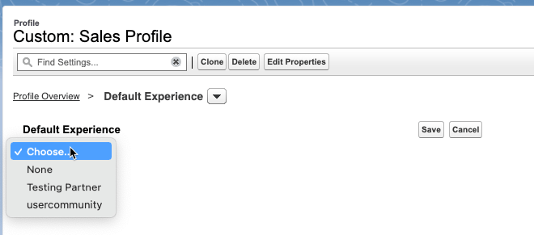

The Salesforce org you are working with might have more than one Experience, and your users may be able to access more than one Experience. In this scenario, you would likely want your users to default to a selected community, including all communications coming out of Salesforce. To do this is quite simple.

Go to Setup --> Profiles --> Select the desired Profile and click Default Experience in the System section

From here you will see a dropdown of any active Experience sites, click the one you want as the default and click save.

Here's a word from the Salesforce [documentation](https://help.salesforce.com/s/articleView?id=sf.network_affinity.htm&type=5):

"All members who are assigned the user role are associated with the selected default experience. When they receive email notifications about network-agnostic objects, like accounts, cases, and opportunities, links in the notification emails lead back to the default experience. When they receive their new-user email or notifications about password resets, links in those messages also lead back to their default experience."
