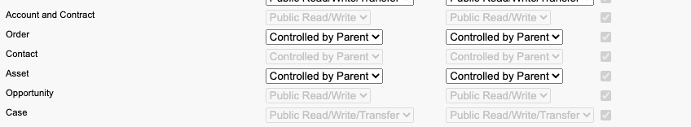
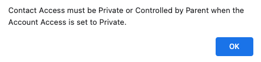
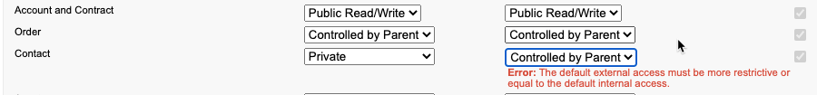

When setting up your Salesforce instance, it is important to consider your sharing settings for the Account, Contact, Opportunity, and Case objects. This is because these objects are the most tied together in how they can be set up.

<figure>

<figcaption>

Greyed out represents when the Account is changed all others that are changed

</figcaption>

</figure>

If you want your Contacts set to anything other than Private, your Account settings will need to match that.

Contacts can be set to Controlled by Parent (Account), Public Read Only, Public Read/Write, and Private.

It is possible to have Contacts set to Private but Accounts not.

If you are considering setting your Account to Private, plan to create sharing rules for both Contacts and Opportunities.

If you have both internal sharing and external sharing, your external sharing can never be greater than your internal sharing.

