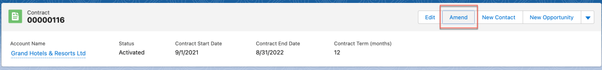
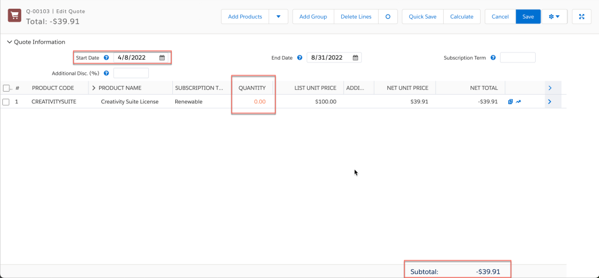
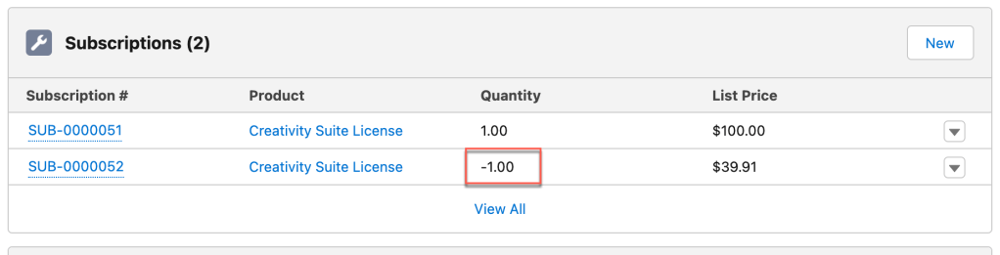
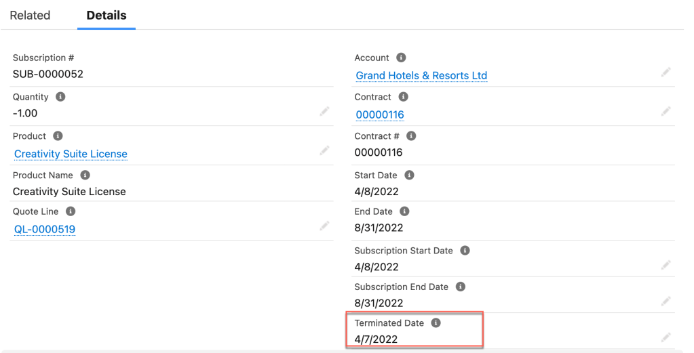

This post will review the best practices for doing a Rip and Replace scenario in CPQ.

First, let's define Rip and Replace: This is when you take an existing Contract in Salesforce and cancel all of the lines, with the intention to create a net new Contract. The most common reason for doing this action is because you want to [Amend and Extend](https://sf9to5.com/2022/03/29/how-to-amend-extend-contract-cpq/) your Contract. Other reasons could be that the customer wanted to make their changes but start on fresh paper. Whatever the reason may be, you will always result in a cancelled Contract and a new Contract when doing this scenario.

Now for the steps:

Go to the Contract that you want to cancel out and click the Amend button.  

On the QLE, update the Quantity of every line to zero.  
You may have difficulties doing this step due to quantity minimums that might be set through Features, Options, or Validation rules. Therefore, I would advise testing this out in the sandbox first and making the necessary adjustments to resolve this.  

Ensure that the Start Date is set to the date these lines should end and do not touch the End Date.

After all the lines are zeroed out, save and close the quote. Either order the quote and contract the Order or directly contract the Opportunity (depending on your typical flow and whether or not you need an order).

After the contracting process is complete, you will see the negative lines on the Contract and the Terminated Date.  

<figure>

<figcaption>

Negative Subscription Line

</figcaption>

</figure>

<figure>

<figcaption>

Terminated Date on the Subscription

</figcaption>

</figure>

Unfortunately, Salesforce does not update the status of the Contract itself automatically, so if you need this to update for reference purposes, you will need to update the [options in the picklist](https://help.salesforce.com/s/articleView?id=000352972&type=1) and create a flow if you want this process to be automated. I would recommend using the Terminated Date on ALL of the Contract lines to indicate that this has been cancelled completely.

If you are using Service Contracts, the status will change but only after the original Service Contract End Date is in the past. Canceling all of the lines does not automatically update the Status field. You may want to consider a custom Status field on the Service Contract that you can control separate from the one in the package.

From here, all you need to do is make your new Opportunity, Quote, and Contract as you usually would. However, please bear in mind from a reporting perspective that when doing a Rip and Replace, there is no connection between the "Rip" Contract and the "Replace" Contract.
