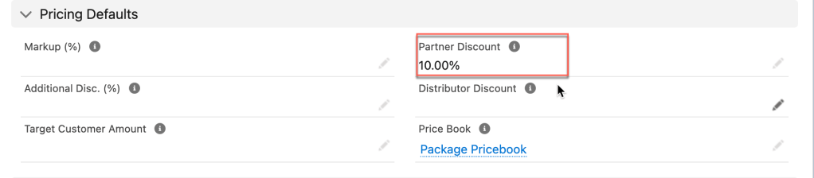
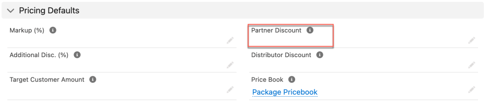

While some companies set their Partner Discounts and Distributor Discounts on the Quote level using Price Rules and lookup data, others might choose to enter the data per Quote manually. In either scenario, it is crucial to understand that the data will not automatically end up on the Renewal quote when going through the Renewal process.

<figure>

<figcaption>

Original Quote

</figcaption>

</figure>

<figure>

<figcaption>

Renewal Quote

</figcaption>

</figure>

So what does this mean? It means one of two things depending on how you set these values.

1. If you are using a Price Rule to stamp these values, ensure that they are also running on Renewals
2. If you are manually entering these values, create a Price Rule that pulls the value from the Original Quote to the Renewal Quote - you can follow the same type of logic used for [Percent of Total Discounts](https://help.salesforce.com/s/articleView?id=000319053&type=1), but remember you are doing this at the Quote, not the Quote Line

One other thing to note is that this issue is only for the discounts at the Quote level. So if your discount is at the Quote Line level, this populates correctly on the Renewal.
