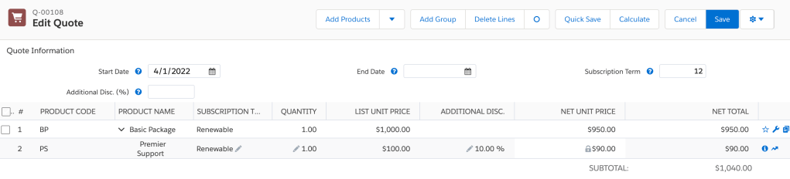
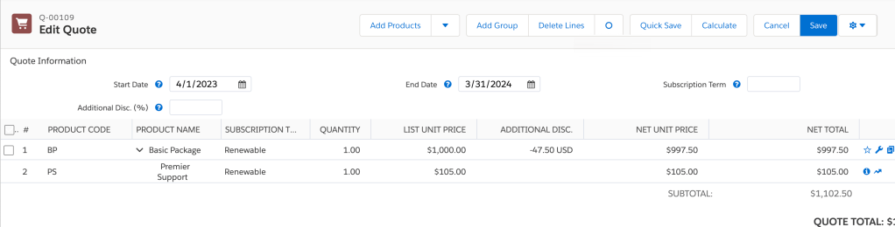

I've been writing a lot about Percent of Total products recently, and this has stemmed from the fact that the Percent of Total products seem to have a lot of nuance to them, that if you are paying attention, it might come back to bite you later on down the road.

This article is a perfect example of that. Recently I had a client giving discounts on their Percent of Total products, and we were introducing Renewals into the mix. They have their [Renewal Pricing Method](https://sf9to5.com/2019/02/19/cpq-renewal-pricing-method/) set to Same, and I noticed that the discount was not coming over when creating the Renewals.

This is a known Salesforce limitation, and you must create a Price Rule to pull the discount from the original quote to the Renewal quote. Why is this a thing? I have no idea since I would have assumed that this would be covered by all of the twinning and other logic that Salesforce has for Renewals, but that is the case.

To accurately set up the price, I recommend following the detailed steps listed in this Salesforce [help article](https://help.salesforce.com/s/articleView?id=000319053&type=1).

If you are doing discounts and you have your Renewal Pricing Method set to Uplift, this likely will not behave how you would expect. Instead of uplifting the post-discounted price, the system will set the price back to the List value and then uplift from there. You can see this in the images below.

<figure>

<figcaption>

Original Quote with Discount

</figcaption>

</figure>

<figure>

<figcaption>

Renewal Quote with Uplift

</figcaption>

</figure>

Renewal Method of List is the only version you do not need to worry about, and this is because the definition of List is to remove the previously applied discounts.
