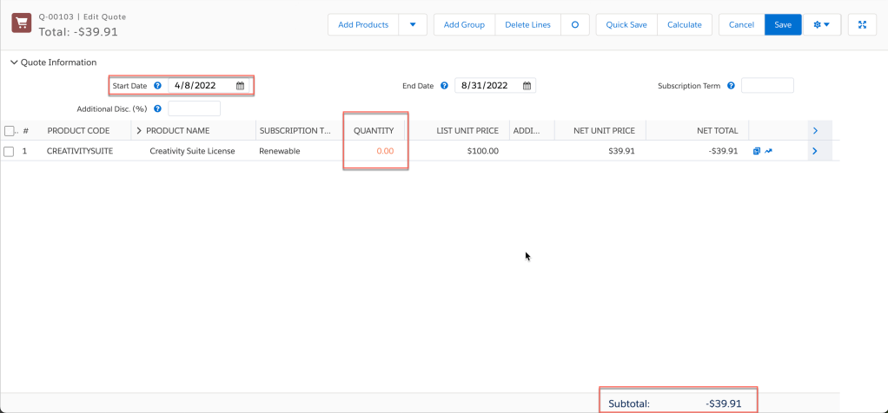
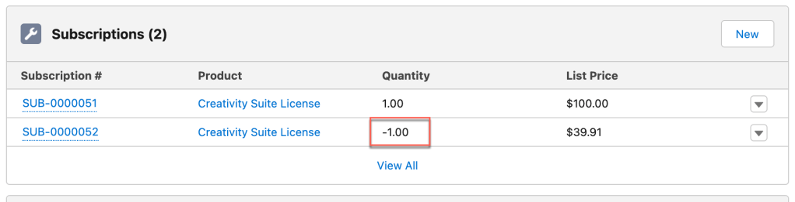
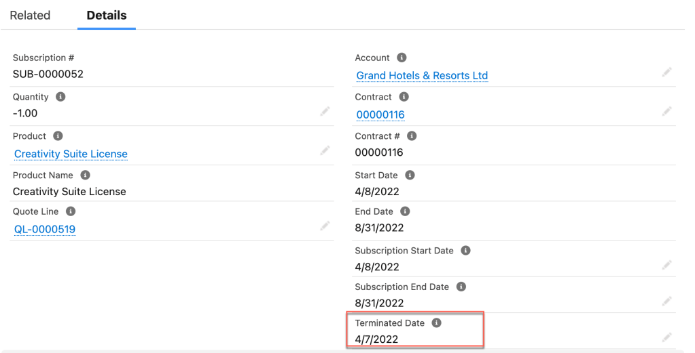

Canceling a Contract or churning a Contract in CPQ can mean different things depending on the scenario you reference. The first scenario could be that you are referring to not renewing a Contract, meaning the customer did not want to continue past their contract date. The second scenario could be taking an existing contract and ending it in the middle. This article aims to walk through the steps of the second scenario.

To properly cancel a contract, you need to do an amendment action in which you zero out all of the Quote Lines on the Contract.

  
Due to quantity minimums that might be set through Features, Options, or Validation rules, you may need to do some build to get around this, and therefore I would recommend testing this in the sandbox first.

It is essential to keep in mind that you will end up with a net negative quote, prorated for the remainder of the time on the contract when churning a contract. This is because Salesforce assumes that you are providing a refund for the remainder of the time if you are doing this action.

Therefore, if you enforce the payments through the end, or if the customer has already paid in full and you will not be providing a refund, I would not recommend going through this process. Instead, if you have a subscription that is not being refunded, you would let the contract complete and then not renew the customer.

Once all the lines are churned (zeroed out), you can contract the Quote through the Opportunity or the Order, depending on if you need an Order for this process.

Your Contract will end up with new negative lines for all items churned; however, there will be no indicator on the Contract that it has been terminated.  

<figure>

<figcaption>

Negative Subscription Line

</figcaption>

</figure>

  
The Subscription Lines will have a Terminated Date of the date you cancelled everything.  

<figure>

<figcaption>

Terminated Date on the Subscription

</figcaption>

</figure>

  
If you want your contracts to reflect this cancellation/churn, you can add a value to the Status picklist and then have automation based on the Terminated Dates to set it.

If you were using Service Contracts, I would create a custom Status field that can be set using automation for any Status updates you want to track.

And that's it. You have officially cancelled/churned the contract.
