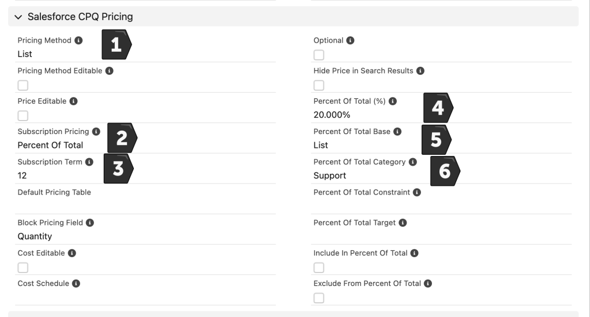
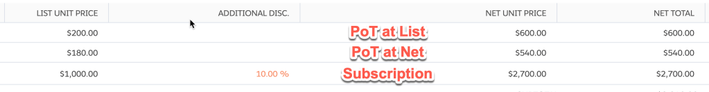

If you are looking to have a product that has its price calculated by another product or set of products, you will want to set up a Percent of Total product. Doing this requires a couple of steps.

First, on the Product record that will be the Percent of Total product, you will want to make sure the following fields are populated:

1. Pricing Method - This should be List if it is a Subscription, it should be Percent of Total if this is not a Subscription
2. Subscription Pricing - This should only be populated if this is a Subscription product and should be set to Percent of Total
3. Subscription Term - This should only be populated if this is a Subscription product
4. Percent of Total (%) - This is the percent of the price that you want this product priced at
5. Percent of Total Base - This is the value of the other products that you want to take the percentage value of. Options include: List, Regular, Customer, or Net
6. Percent of Total Category - This is probably the most important field, as this is the link between the Percent of Total products and the products that you are taking the percentage of. The value here needs to match the other products. If this is left blank the Percent of Total function will not work.

Once you have the Percent of Total Product setup, you will need to update the products from which the calculation will occur. There are three fields here to consider:

1. Percent of Total Category - this needs to match the Percent of Total Product
2. Include in Percent of Total - by default Salesforce does not include Subscription products in the calculation, so you need to make sure that this is checked on any Subscription product you want to include in the calculation
3. Exclude from Percent of Total - this is to exclude any non-Subscription product from the calculation

Keep in mind that when you make a Percent of Total a Subscription product, it will prorate based on the term. This is regardless of your value is List or Net. In the case of List and a 36-month term, it will be the percentage of List price multiplied by three years; in the case of Net and a 36-month term, it will be the percentage of the Unit Price after discounts prorated for the three years.

There are additional caveats to setting up an MDQ related Percent of Total product that I will cover in a separated post.
