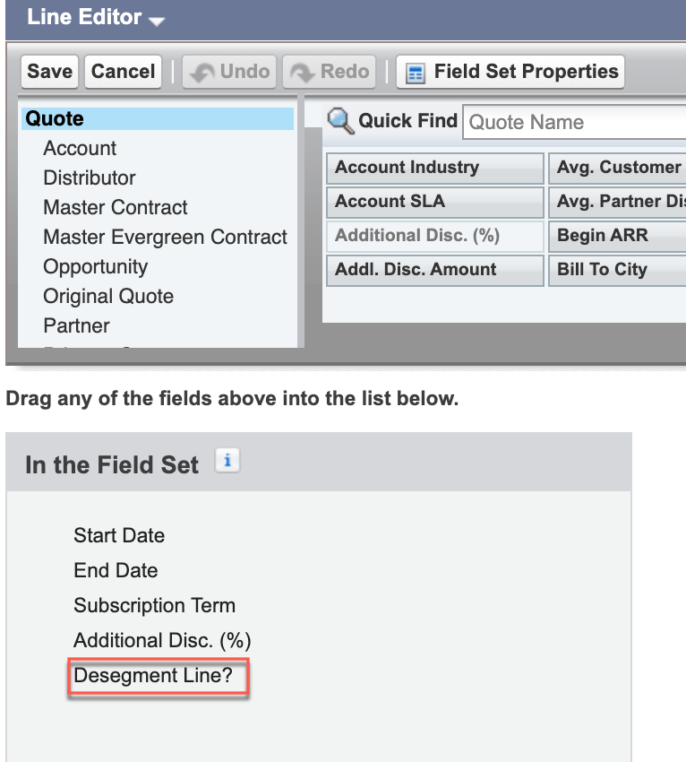
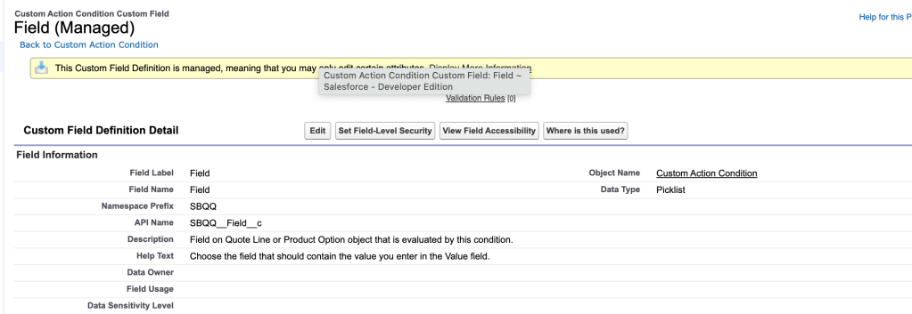
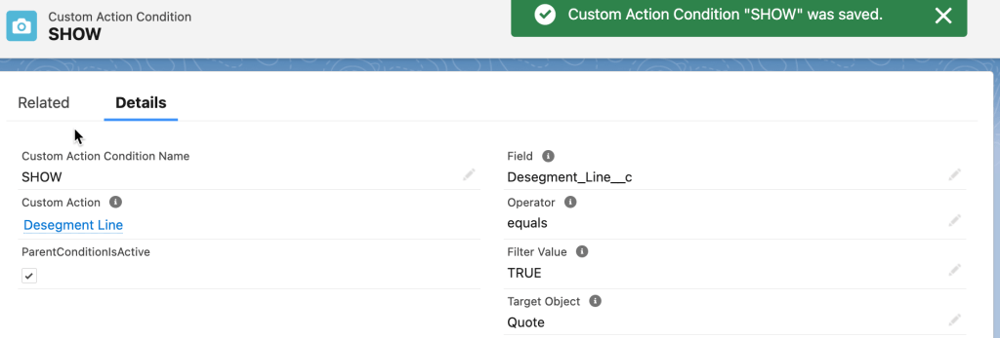
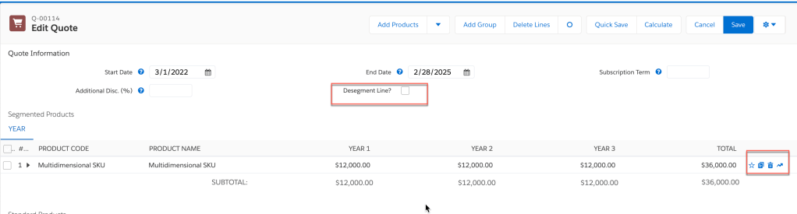
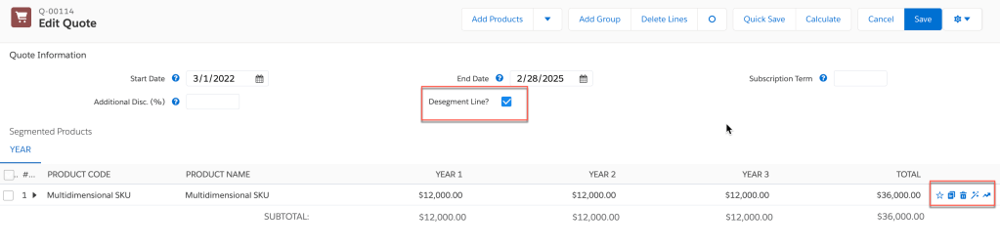

When you have MDQ products set up in CPQ, you automatically get the Wand icon which you can use to segment or desegment the products. Out-of-the-box, these icons are visible and easily clickable.

However, if a user desegments a product they have spent time setting up, they will lose all of the work (unless they Quick Save before desegmenting). Salesforce does not provide a way to throw a warning message when clicking the desegment icon.

Still, they recommend the following treatment to make desegmenting harder to access and therefore enforce behavior on the user to ensure the action they are taking is desired. The process Salesforce recommends is to create a field that the user can check, and by doing it will show the desegment wand.

STEPS:

1. Create a new field on Quote - I called mine _Desegment Line?_
2. Add the field to the Line Editor Field Set on Quote  
    

3. Update the picklist value for the Field field on the Custom Action Condition object  
    

4. Find the Desegment Line Custom Action
5. Create a Custom Action Condition to match as below using your field name  
    

TESTING STEPS:

1. Open a Quote with an MDQ product on it
2. Note that when the field is unchecked, the wand is not visible  
    

3. Mark the checkbox field as TRUE and click Quick Save
4. Note that the field is now visible  
    

That's it! Now you have a way to ensure that the users don't accidentally desegment their lines.
