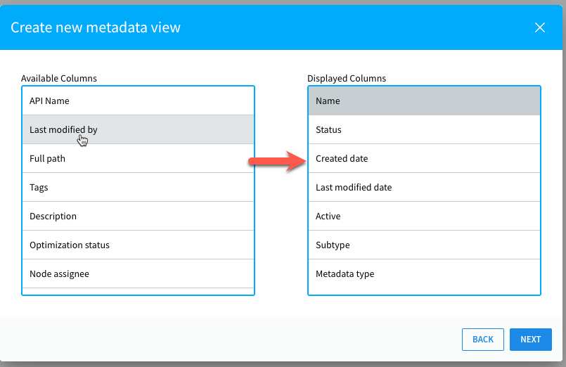
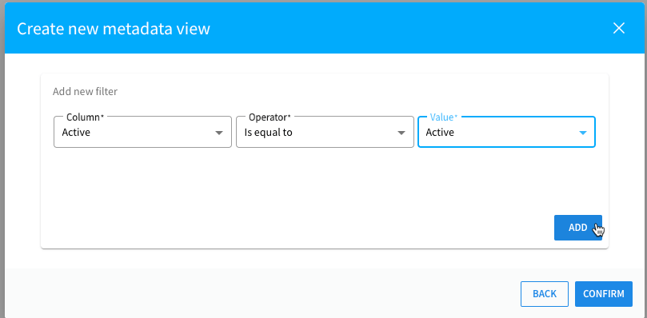

Dunnings - a word that my computer dictionary does not believe is real, but I promise you it is. It is the process that collections agents go through when they want to try and collect payments that are late or overdue.

As the Revenue Cloud ecosystem grows to include the Finance side of the house, folks are looking for more ways to automate and make various parts of the process easier to manage. One of these streams is the Dunnings and Collections process. It includes all the steps a collections agent will take to try and resolve an overdue payment, including email notifications or even canceling the product.

While not included in the Salesforce Billing package, there is a Salesforce Labs package that adds the Dunnings process to the system. This article will walk you through how to set up the Dunnings package using what comes in the package. In a later post, I will go into some of the creation of automation that can be stacked on top of the package.

Step 1: Install the package - do it for everyone who will need access to the Dunnings objects  
https://appexchange.salesforce.com/appxListingDetail?listingId=a0N3A00000FMiUhUAL

Step 2: Using the documentation provided by the package add the items to the various page layouts  
https://appexchange.salesforce.com/partners/servlet/servlet.FileDownload?file=00P3A00000l4RhfUAE

Step 3: Time for the real stuff. Go to the Collections Management App and go to the Dunnings Method tab

On the Dunnings tab click New and then give the Dunnings Method a name. Typically this might be Basic or Standard and then VIP or At Risk. This will be highly dependent on what your Collections team needs.

Step 4: Now we need to create activities for the Dunnings Method. From the Related tab from the Dunning Method above click new in the Dunnings Activity.  

Give the Activity a meaningful name for what the activity will be.

The Activity Subject, sticking strictly with what comes out of the box, will be one of the following:  

This will become the subject of the task created for the Collections Agent (we shall see that soon).

Lastly give it an Offset Days value - this is a value based on the Collections Plan date and can be positive (after the Collections Plan start date) or negative (before the start date).In the out-of-the-box functionality, setting negative will not serve any real value.

For my example, I have three activities, as you can see here:  

Step 5: Start making the Dunnings Methods applicable in the real world. To do this, we need to update the fields that were added to the account in Step 2. 

On the Account you need to set which Dunnings Method will apply, who will be the Collections Agent, and who the Bill To Contact will be. These fields are required for the out-of-the-box triggers to work.

Step 6: Generating a Collections Plan. A Collections Plan is a record that applies the activities associated with the Dunnings Method and assigns them to the Collections Agent to take action on. To trigger this creation, set the Collections Status field on the Account to In Collections. If you have a Collections Plan Date, it will use that as the start date, else it will use today as the start date.

In the screenshot above, you can see all of the information we previously filled out come into play. The fields pulled from the Account information and the Activity tab on the right show the activities we created and when they were due based on the start date of the Collection plan.

From this point, the Collections Agent can complete their tasks and close out the Collections Plan. Changing the status on the Collections Plan does not automatically change the status.  

The next time the Account goes back for collections, set the Collections Status again on the Account to In Collections and it will make another Collections Plan.

After you have been using the package for a while, you will be able to start reporting on the behavior of the different accounts. The package comes with out-of-the-box reports and dashboards that can be a good place to start.

That's it for the out-of-the-box functionality. It is pretty sophisticated for a free package. However, it leaves much room for improvement with the addition of automation.
