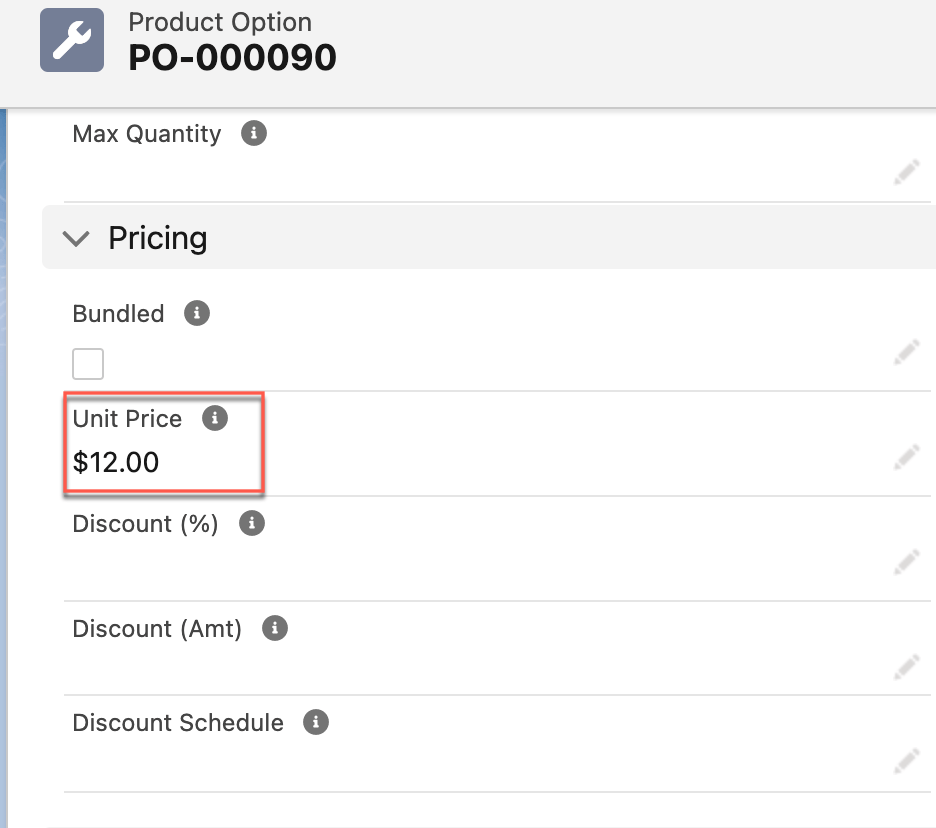
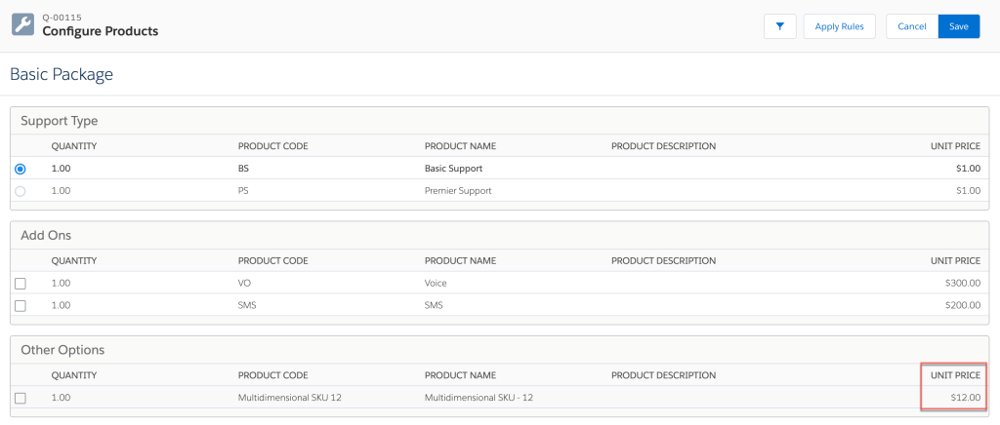
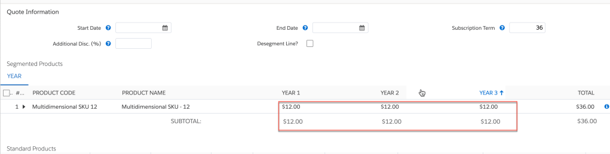
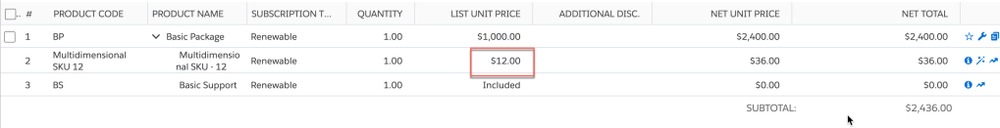
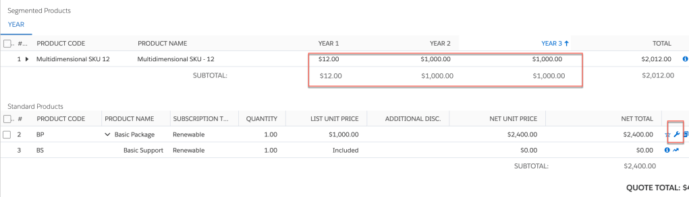
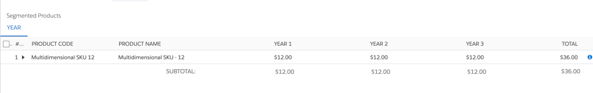

If you have MDQ turned on and are also using the pricing setting on the Product Option record, the following issue has likely happened to you. Unfortunately, the documentation from Salesforce for resolving this is buried, so hopefully, this will provide some assistance.

_Suppose that you de-segment a product option and then resegment it. The first year’s segment applies the product option unit price. However, the remaining segments apply the price book price. To apply the unit price to the remaining segments, navigate to the parent bundle, click Reconfigure, and save. (Product option unit price is dependent on the SBQQ\_\_Bundle\_\_c field set to `True`. Clicking Reconfigure sets SBQQ\_\_Bundle\_\_c to `True`.) All segments then apply the product option unit price._ [**\[SOURCE\]**](https://help.salesforce.com/s/articleView?id=sf.cpq_mdq_guidelines_bundles.htm&type=5)

Steps to recreate:

1\. Check that the Product Option record that is the MDQ product has a Unit Price  

2\. Create a quote with the product; you will see that the Option has the Unit Price from the previous step:

<figure>

<figcaption>

3\. Set your term to something greater than 12 (assuming yearly dimensions) and see the correct values for all years:

</figcaption>

</figure>

4\. Now desegment the line, and you will see the Unit Price is still retained:

<figure>

<figcaption>

5\. Now resegment the line again, and you will see the issue. To resolve, click the wrench:

</figcaption>

</figure>

6\. After you have clicked the wrench and saved it, the pricing will be reset back to the correct value:

This is why your users need to be aware that desegment and resegment can impact pricing behavior. Check out my post on [hiding the desegment wand](https://sf9to5.com/2022/08/17/how-to-hide-the-desegment-button-for-mdq/).
