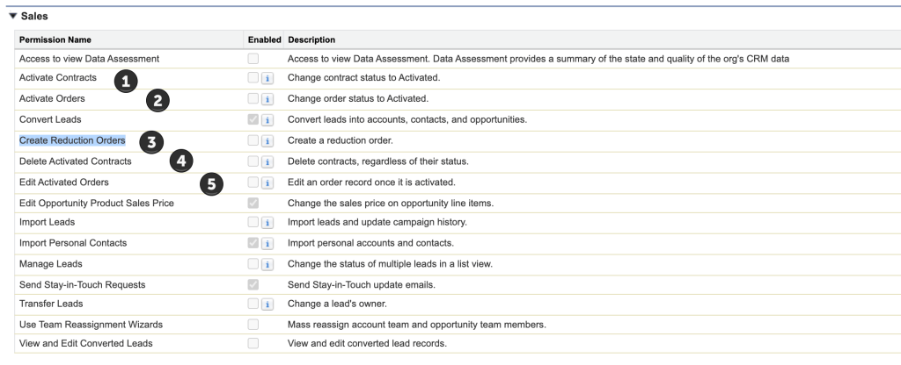

I previously wrote an article describing the different [Order settings](https://sf9to5.com/2020/01/14/how-handle-zero-quantity-orders-cpq/) of Salesforce OOTB. Once you have enabled those settings, some additional adjustments can still be made at either a profile or permission set level to allow users edit activated orders.

All of the below settings are in the App Permissions in the Sales section:

<figure>

<figcaption>

1\. Activate Contracts - this is important if you will be setting the Status field to Active on the Contract object.

</figcaption>

</figure>

2\. Activate Orders - this will be needed if the user will be setting the Order to Active - this is an important step in the ordering process, so any user involved should have this permission.

3\. Create Reduction Orders - this is in conjunction with enabling reduction orders via the Order Settings. This allows a user to be able to take this action.

4\. Delete Activated Contracts - this is a setting that very few people should have given the implications of deleting a Contract.

5\. Edit Activated Orders - this setting is important if you have users that will need to modify something on the Order after it is activated; otherwise, they will get presented with a validation rule.
