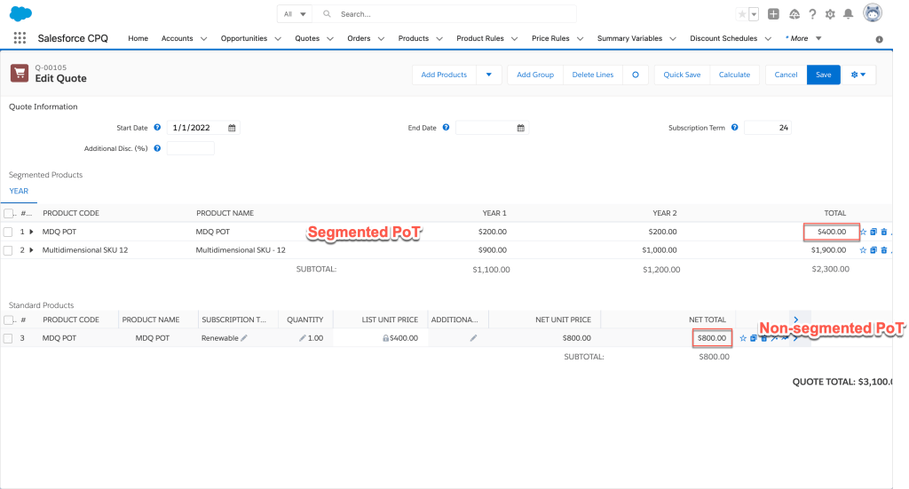
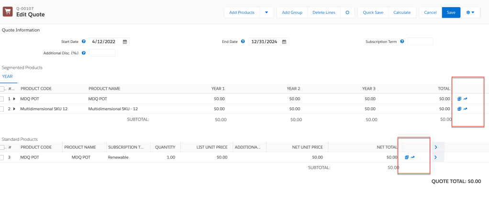
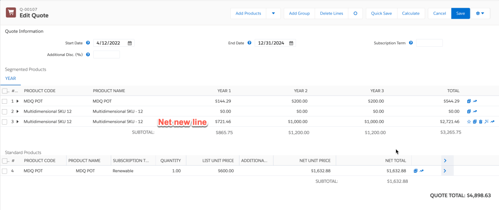

Recently, an acquaintance of mine, Rodrigo Crespo, discovered a funky issue with how Percent of Total products works with MDQ products. This article covers the funkiness and the key things to keep in mind if you set up the Percent of Total products connected to MDQ products. To learn more about MDQ check out my article on how to set them up [here](https://sf9to5.com/2019/12/17/how-to-setup-mdq/).

**Oddity number 1 - Pricing on a new Quote:**

In the image above, I have a Percent of the Total product that can be segmented. It is set based on the Multidimensional SKU's List Price. As you can see, in the segmented section, the total Price for the Percent of Total is $400 because it takes the percentage based on each segment and then adds it up.

On the bottom, you can see the same Percent of Total product as a non-segmented product, and you can see here that the price is $800. This is because it takes this List price of the summed up MDQ lines, then prorates the amount. Again, this is very important from a business perspective to take into account, as it results in very different pricing. You will unlikely want your reps to sell in both formats when the main product is segmented.

**Oddity number 2 - Segmenting on an Amendment**

Above is a picture of the amendment quote. You will see something critical missing from the previous image - the little wand icon that allows you to segment and desegment existing lines on an Amendment.

Why is this important? Well, for the same reason as oddity number 1. Let's say that you had a non-MDQ product on your original quote and had the Percent of Total product as a non-segmented product, and then on the Amendment, go to add an MDQ product. That MDQ product will be segmentable because it is a net new line. However, your Percent of Total product will not be segmentable so you could end up with incorrect pricing.

The rule of thumb is that if you have a Percent of Total products that are segmentable and related to MDQ products, you should always segment them on the original quote.
