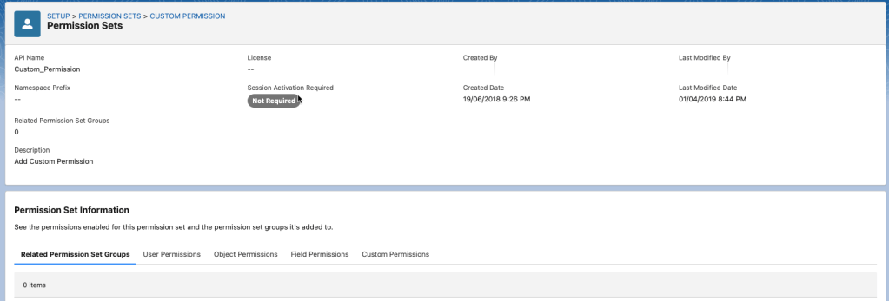
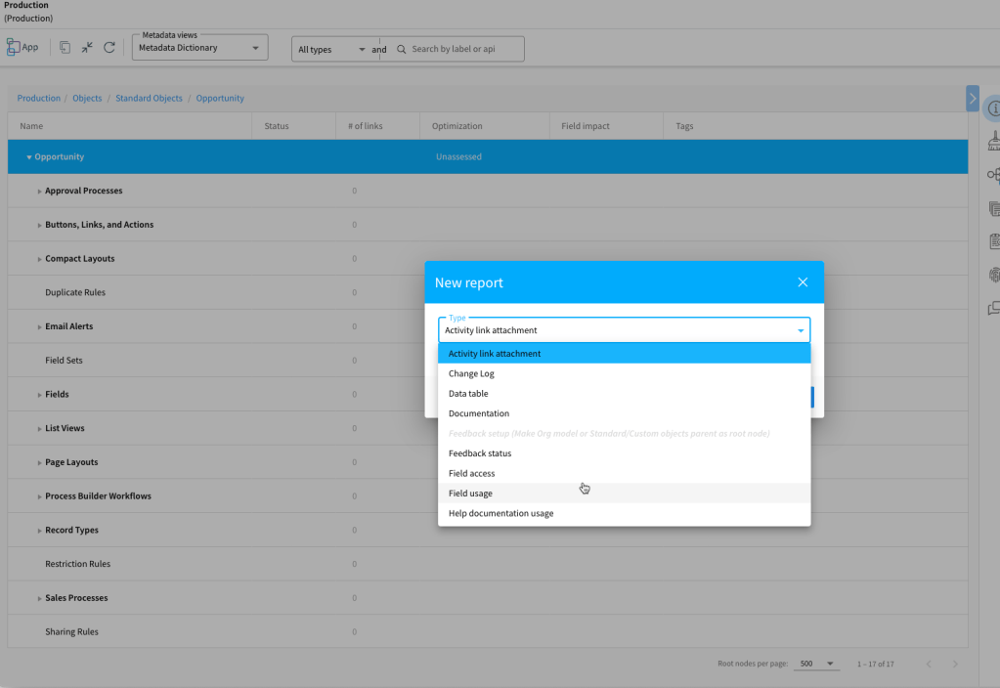

Many folks would love for Salesforce to enable the ability to turn off the prorate functionality for Subscription products. Unfortunately, Salesforce has tied the proration aspect to the ability to create a Subscription/Contract Line Item, which prevents users from having an easy way to have a subscription line with a set price regardless of term. The goal of this post is to assist with turning this off while still being able to get the Subscription record.

Prep work:

- Add SBQQ\_\_SubscriptionPricing\_\_c to the Price Condition and the Price Action Target Field picklists

Product Setup:

- On the relevant product, you will still want it to be setup as a Subscription product.

Price Rule Setup:

- Create a price rule with the following setup (make sure to set the Calculator Evaluation Event). This rule will turn off the proration for calculating the price when in the QLE.

- After you have the price rule for turning the proration off, we will need to setup the Price Conditions and the Price Action

- For the Price Condition, I used a Product Code as my filter. However, if you forsee many products like that, it is best to create a custom field on the Product object and use that as the filter, instead of the Product Code in this example.

Make sure in the Price Action (seen above) that the Value is left empty, as we are setting this field to blank.

- Now we need to create the second Price Rule, designed to reset the value after the calculations are complete. This step is necessary so that when you create a Contract/Service Contract, it reads the Quote Line as a Subscription and creates the Subscription/Contract Line Item.

- We are inverting what we did in the first rule for the Price Conditions and Action.

Go ahead and make sure these are active rules, and then you can go ahead and test. You will see that regardless of the Subscription Term, the pricing of this product will not change. However, post-save, you will be able to see the Fixed Price back on the Quote Line, giving you a Subscription/Contract Line item.
