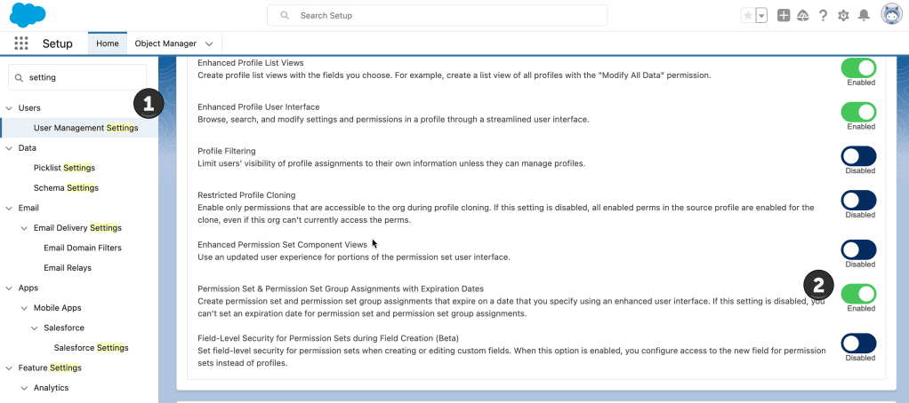
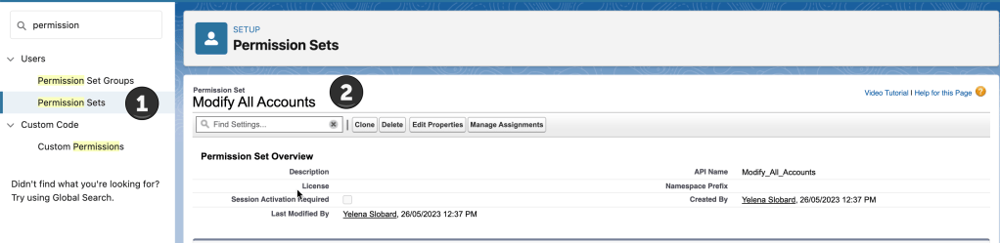
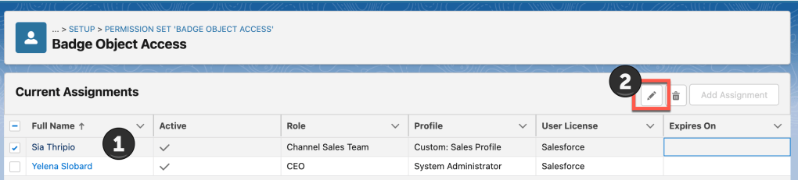
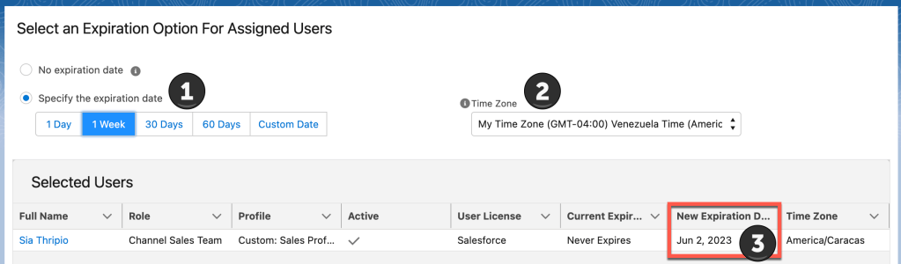

It used to be that when you gave someone permission set but you only wanted them to have it for a limited time, it was up to you to remember to remove the access later. Now, Salesforce has added functionality that allows admins to set expiration dates on individual permission sets or permission set groups, allowing you to not have to remember to remove the access later. One feature to note is when we see the layout for selecting the user to add the expiration date to, this seems to be the new format that Salesforce is slowly rolling out for Permission Sets. In case you were not aware, Salesforce plans to deprecate Profiles almost in the near-ish future, so Permission Sets are truly the way to go.

**Setup**:

1. Go to Setup --> User Management Settings

3. Make sure you have enabled the Expiration Dates setting

1. Go to Permission Sets or Permission Set Groups and select the relevant one

3. From here select Manage Assignments

1. Check the User that you want to apply the edit to

3. Click the Pencil to go to the Edit screen

1. Select the length of time you want for the expiration

3. Set your desired time zone that this will reflect in (you might be in a different geographical location than the user that this applies to)

5. See the Expiration Date update and then you are all set!

This works the same for Permission Set Groups, but you would do the Manage Assignment from the Permission Set Groups instead of the Permission Set.
