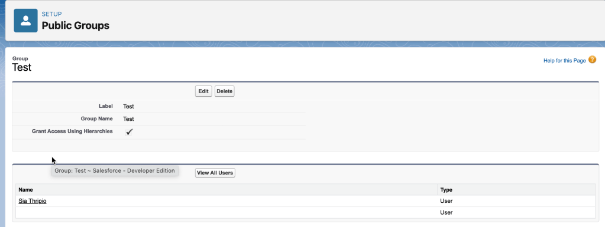
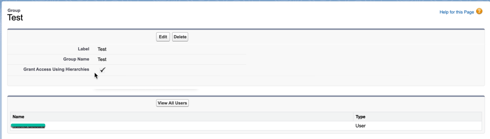
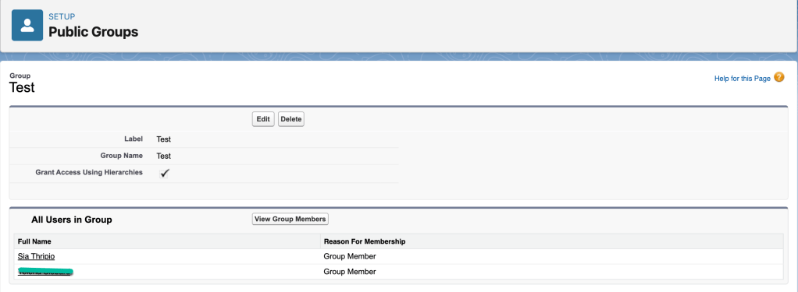

To be honest, I am surprised that I am even writing this, but after the amount of time it took me to resolve the issue, I thought more on the Internet should have easy access to the solution.

About a month ago, I was getting told that someone in senior leadership was still getting an email from our [Advanced Approval](https://sf9to5.com/2021/05/04/set-up-approval-condition-advanced-approvals/) rules even though they had already been deactivated in Salesforce. After checking that they were, in fact, deactivated, I looked into the Approval Rule to see what was going on. The user was not directly the approver since the rule in question had a Group as the Approver. I removed the Approver record, but that didn't result in any change. I checked the group, and initially, I didn't see the user because they were deactivated.

I went back to the user record and saw that the group was still listed on the user detail page. So I went back to the Group detail and selected to see ALL members and then saw the person. Once I removed the user from the group, they no longer received any emails.

Example:

<figure>

<figcaption>

Group view before the User (Sia) is deactivated

</figcaption>

</figure>

<figure>

<figcaption>

Group view after User (Sia) is deactivated

</figcaption>

</figure>

<figure>

<figcaption>

Group View when you click the View All Users

</figcaption>

</figure>

This is a very odd bug, as I cannot imagine that this is by design, but TLDR is that when you deactivate a user if they were part of a group and that group is part of an Advanced Approval rule, they WILL get emails until they are completely removed from the group.
