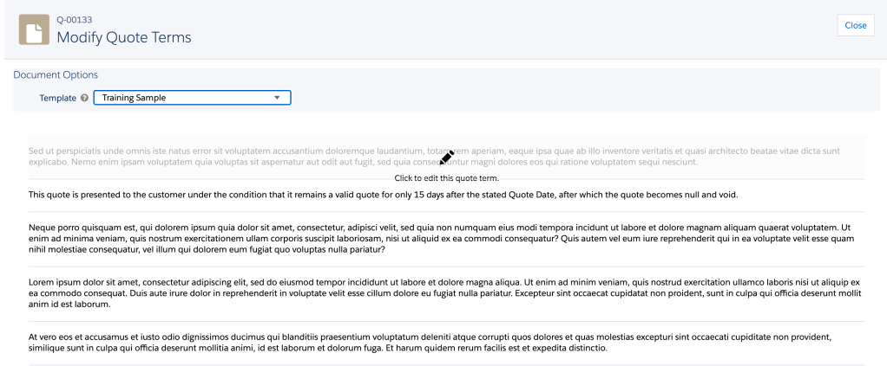
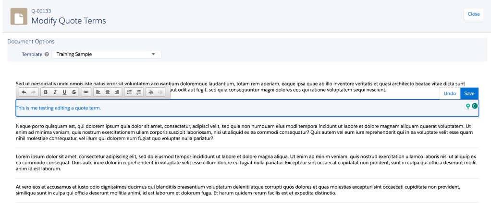
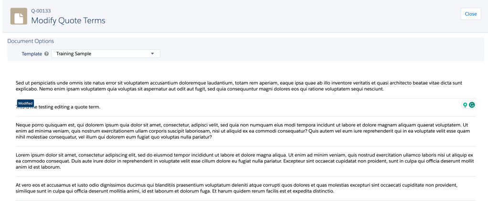
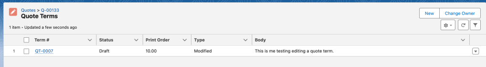

The specific action of modifying Quote Terms within a quote document is a crucial functionality that caters to the dynamic nature of business negotiations and agreements. When dealing with sales representatives and various stakeholders, adjustments to the language or terms included in a quote are common. The Modify Quote Terms button is a valuable tool in these instances, offering a seamless way to address such changes.

By integrating the Modify Quote Terms button into the Quote layout, users can navigate to a comprehensive list of all applicable Quote Terms for a specific quote with just a click. This accessibility ensures that users can quickly locate and assess the relevant terms, facilitating efficient modification processes.

Upon entering the Modify Quote Terms page, users encounter a user-friendly interface that visually distinguishes editable Quote Terms through a distinct pencil icon, providing clear indication and seamless navigation for making necessary adjustments. Furthermore, the ability to promptly save the modifications enhances the workflow, assuring that the updated terms reflect the latest negotiations and agreements.

In addition, incorporating a "Modified" tag alongside the edited Quote Terms helps maintain transparency and accountability within the document. This labeling mechanism serves as a clear indicator to all stakeholders that particular terms have been altered, thereby avoiding any potential misinterpretations during subsequent reviews or negotiations.

<figure>

<figcaption>

Ability to view modified quote terms as a related list on the Quote object

</figcaption>

</figure>

It's also worth noting that while the Modified tag provides visibility of changes, it's essential to exercise diligence by comparing the original and modified terms to fully comprehend the extent of the modifications. Although Salesforce currently lacks a built-in feature for side-by-side comparison, the clarity provided by the Modified tag combined with the updated Quote Terms related list helps effectively track and manage alterations.

Overall, the Modify Quote Terms feature streamlines accommodating revisions within quote documents and contributes to maintaining accuracy, transparency, and integrity in the negotiation and agreement process.
