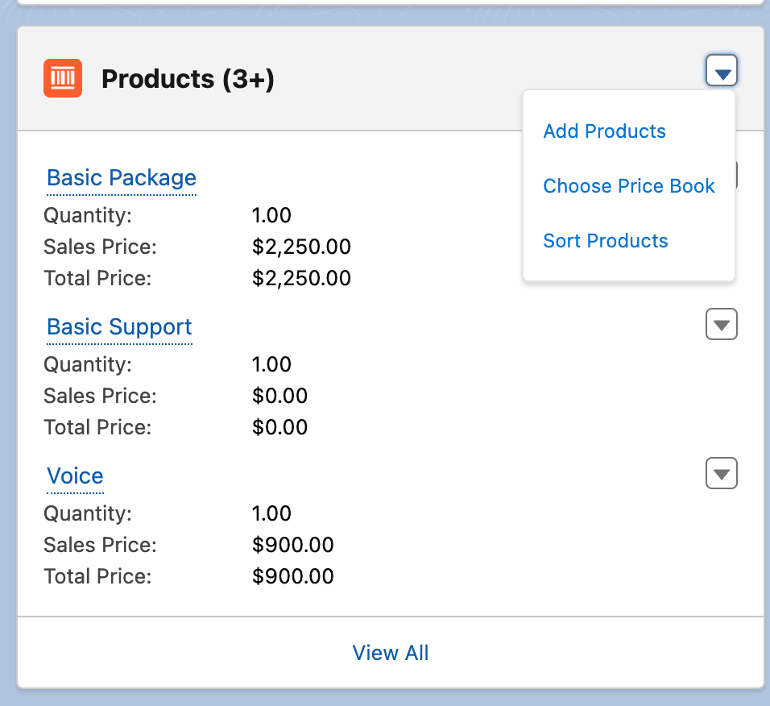
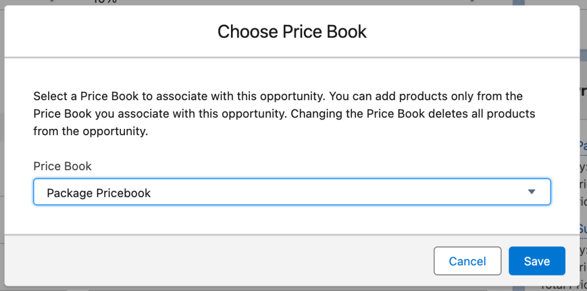
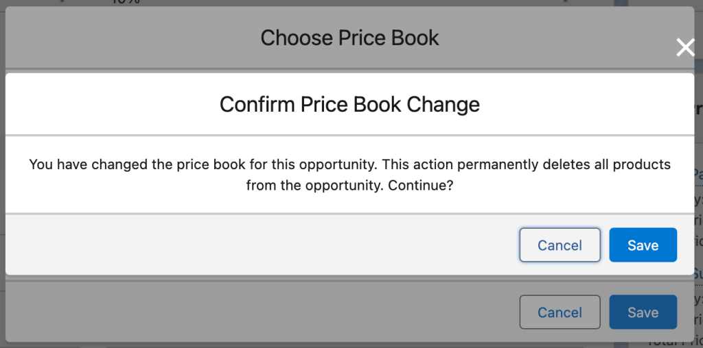

Short and simple. The way to change pricebooks on an Opportunity has gotten a whole lot easier.

In the past, if you had a Quote and/or Opportunity Products attached to the Opportunity and wanted to change the pricebook, you first had to uncheck the Primary checkbox and remove all of the products from the Opportunity Products list. This multi-step, very hard-to-train process is now gone!

How to change Pricebook in the modern age:

1\. Navigate to the specific Opportunity where you want to change the Products-related list. You can do this by selecting the relevant Opportunity from the list of available opportunities.

2\. Once on the Opportunity page, proceed to the Products-related list and locate the down carrot. Clicking on this will reveal a set of options.

3\. From the options list, select "Choose Pricebook" to change the pricebook associated with the products on the list.

4\. Following this action, a dialog box will appear, presenting a warning message. This message reminds you that some products may be currently listed under a different pricebook, and changing the pricebook selection could result in the deletion of these products. A drop down menu will also be available for you to select the correct pricebook from the available options.

5\. If products are listed under a different pricebook, another warning message will pop up, prompting you to double-check and confirm that you are indeed willing to proceed with deleting products associated with the previous pricebook.

6\. Once you have carefully considered the implications and made the necessary selections, proceed to click "Save." This action will remove the products linked to the old pricebook and reflect the updated pricebook in the Products related list.
