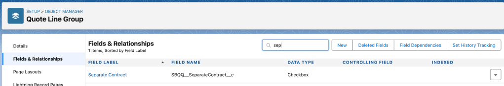
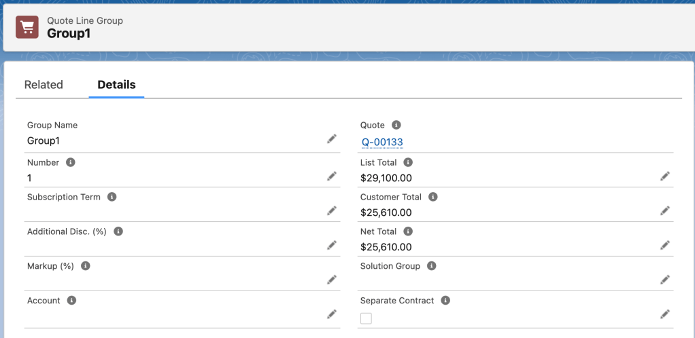

A recent-ish feature that Salesforce introduced for CPQ is the ability to split contracts by groups. In the past, without any additional logic, you only had the option to split contracts by the end date of subscriptions or keep it all in a single contract. Now we have a new option, and this article is going to walk through the steps to get it set up.

First, it is important to note that this only works if you contract directly from the Opportunity. If you contract from Orders, this will not work.

For the setup, you must ensure that the field "Separate Contract" is on the Quote Line Group Object.

Next, make sure you add the field to the Quote Line Group page layout.

To utilize the field, create a quote with at least two groups.

If you want to create separate contract records, check the Separate Contract field on ALL groups before contracting. If you do this after contracting, the process will not work.

Salesforce gives you the flexibility to decide whether you want to keep some contracts combined and some separate based on the group. If you want some groups to be together, leave that field blank on those Quote Line Group records.

A reminder that this does not work when contracting from Orders, only from Opportunities. To learn more about contracting, check out my article on [Short Intro to Service Contracts](https://sf9to5.com/2020/02/25/cpq-service-contracts/), and for ordering, check out [Should I use Orders in CPQ](https://sf9to5.com/2022/10/12/should-i-use-orders-in-cpq/)?
