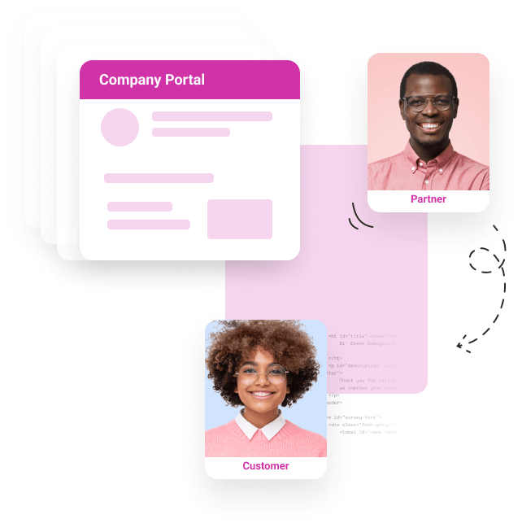
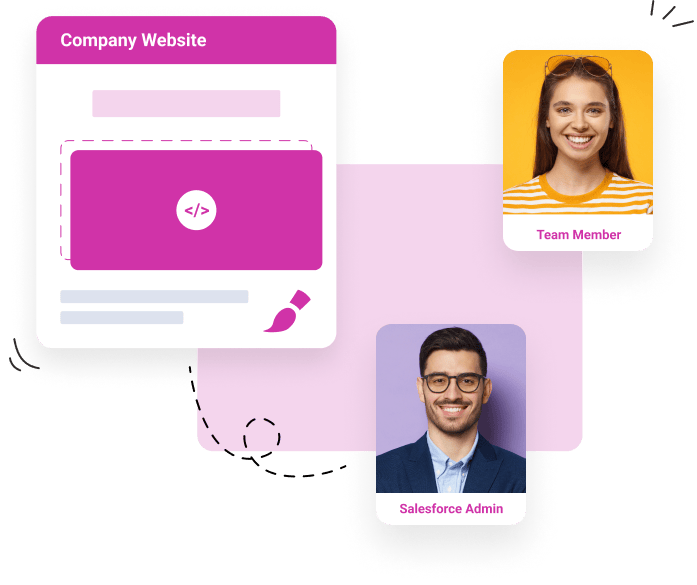

\*\*_This is a sponsored post from Titan Web written by Nikita Rowe._\*\*

Salesforce is the world’s leading customer relationship management (CRM) platform. This is unsurprising, as the software provides top-notch customer experience solutions for teams across an organization. However, there are a few restrictions regarding using Salesforce Experience Cloud. 

Even though the platform connects customers to businesses in more ways than ever, it is imperfect. Join us in the article below to see what your software _curbs_ could potentially look like so that you can plan for the best project launches with Salesforce. Let’s get started!

## What is Experience Cloud?

You might remember it by its previous name, **Community Cloud**. Nevertheless, Experience Cloud from Salesforce is a robust platform used by designers to create branded:

- Online Communities

- Portals

- Websites

These web applications can engage with customers, leads, partners, or employees whenever they interact with your business. As customer standards have increased over the years regarding what they expect from business interactions, it’s important to make the most of your Cloud to produce the best digital experience in Salesforce. 

## 10 Factors Restricting Seamless Software Experiences

Salesforce Experience Cloud is a powerful platform for creating WEB applications. However, it is not a flawless piece of software. Like all things in life, it comes with a few restraints. Let’s examine those so that you can better plan your web projects, processes, and software systems.

### Limitation #1 - Full Customization is Difficult to Master

With Experience Cloud, designers get many customization options for web applications. However, suppose they need tools and features to help them create custom web applications to match a specific business project or process. In that case, they will need extra skills or technical knowledge in the following topics:

- Advanced Salesforce Knowledge

- Apex 

- Visualforce

- Lightning Components

- Third-party Integrations

#### Salesforce Cloud: Customer Experience Management 

Businesses with customers who want a _unified journey_ and require a custom web cloud experience will need to provide user training to employees so that they can create, manage, and use Experience Cloud effectively. 

### Limitation #2 - Design Restrictions

At its core, Salesforce is a customer relationship management platform. It is massively successful, allowing businesses to create web applications with the Experience Cloud offering. However, as Experience Cloud is not the business's main product, it does not offer designers as much **flexibility** as other dedicated web development platforms. 

For example, suppose a business requires a web project to have custom styles, unique designs, and a complicated user interface for a project. In that case, they will need help from expert developers to complete the design requirements and digital experiences in Salesforce. 

### Limitation #3 - The Cost of Salesforce User Licenses 

Unfortunately, this experience platform is not FREE to use. If you want to use the premium software at your company, you need a specific license. Finding the costs is a complicated endeavor. You first need to choose a Salesforce edition and then decide what project you would like to build, such as:

- Do you want to build a connected portal?

- Do you want to create Salesforce digital experiences?

- Do you want to design projects to collaborate with partners or external teams?

- Do you want to create custom sites or external applications?

- Do you want to distribute your content across multiple platforms? 

This can become costly for businesses with many users, as each edition has a unique price. Additionally, the pricing models are challenging to understand as there are many different types of licenses: 

- Customer Community 

- Partner Community

- And More

### Limitation #4 - Content can be Unmanageable 

Don’t get us wrong, Salesforce Experience Cloud does have some _content management tools_. However, they are not as advanced or straightforward to use as the ones created by CMS platforms. Additionally, Experience Cloud cannot comfortably support large volumes of content.

### Limitation #5 - Issues with Performance as Business Scales

Performance issues may arise when your community grows and requires more data handling in your Experience Cloud web projects. Although this is a hindrance, your business can plan and invest in solutions to these performance problems before they occur. 

### Limitation #6 - Upskilling Required

If your business is new to Salesforce, your administrators and developers will face a steep **learning curve**. This means that your managers must add extra time to their schedules when implementing new projects and processes, as employees need to learn to use Experience Cloud.

### Limitation #7 - Needs Internet Access

Your business must be connected to the internet to access Experience Cloud’s best tools and features. Although a few offline tools exist, this obstacle can stop employees from performing their tasks in remote areas without stable internet access.

### Limitation #8 - Complicated Integrations with Cloud Alternatives 

Salesforce Experience Cloud connects well with other applications and systems, but integration challenges can still occur. Businesses often face linking issues when they have non-Salesforce platforms and old systems. 

### Limitation #9 - Fussy Features

Experience Cloud’s search function may not meet your business requirements. If you have a unique process and need advanced search functionality, you will need help from a Salesforce developer to implement additional customization. 

You will be happy to hear that Experience Cloud has powerful reporting and analytic tools for customer relationship management data. However, they are complicated to set up from a non-technical perspective. 

### Limitation #10 - Managing Security 24/7

As long as you work with data, security and who has access to it will always be a huge concern. Salesforce is a PREMIUM product, but you need professionals to help you configure your security and access control settings to ensure unauthorized users cannot access your business data. With robust security measures, these professionals can also help you avoid data breaches. 

However, this is an ongoing task, so prepare for it when establishing goals, budgets, and project plans. 

## Alternative Salesforce Solutions

If Experience Cloud's limitations prevent you from giving customers and employees what they need, you could elevate your CRM platform with a third-party application. We recommend [Titan Web](https://titandxp.com/salesforce/cloud-experiences/)! This **no-code software** can help designers build websites, portals, forms, or surveys on one platform to connect directly with customers, employees, and partners. 

It also seamlessly integrates with Salesforce, using bidirectional data flows to your projects so you can rapidly perform business processes. Furthermore, Titan Web maintains and keeps your customer and business data in Salesforce secure, as it complies with leading frameworks like HIPAA, SOC 2, ISO, and GDPR. Whether your business is large or small, we suggest you check out Titan Web. 

It connects and extends Experience Cloud, as well as:

- Health Cloud

- Financial Services Cloud

- Education Cloud

- Commerce Cloud

- Marketing Cloud

As a _robust alternative_, it can help build secure and user-friendly experiences to connect your employees, partners, and customers to your organization. 

## Discovering More About Experience Cloud

Thanks for reading our article on Salesforce Experience Cloud's limitations. We hope we have given you an idea of the hurdles your business could face if you implement the platform in your systems. This is not to scare you but to give you the information you need to plan and execute the best projects up front. We also provided an alternative software solution that can reshape your projects and processes to work for you with NO CODE. 

Now, go forth and create web projects while mitigating any common potential risks! Good Luck :)
