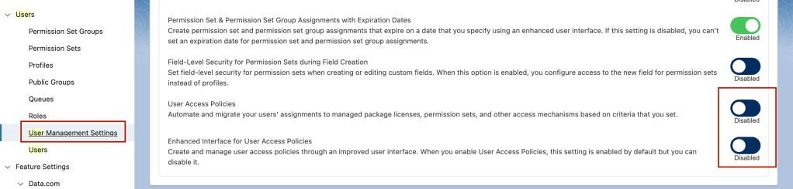
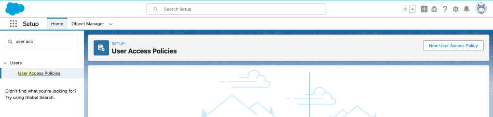
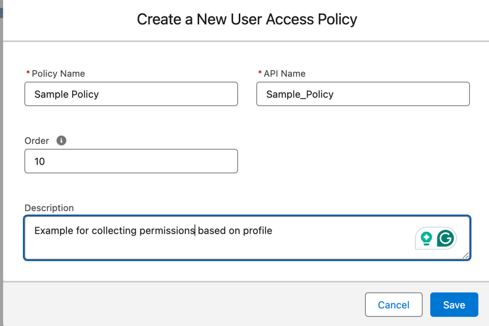
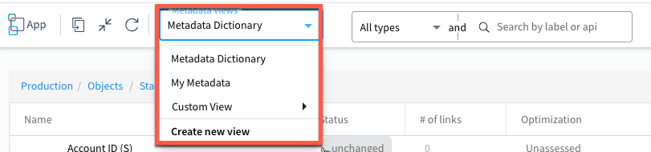

With the Winter '24 release, Salesforce has officially rolled out its new User Access Policies, which are now generally available (GA) for all customers. But what exactly are these User Access Policies, and why should you care?

User Access Policies are a powerful new feature designed to automate user access controls without the need for complex flows. These policies allow administrators to streamline the assignment of specific permission sets, permission set groups, Public Groups, and even package licenses to users, all based on their role or profile.

Imagine you’re managing Salesforce CPQ. You need to ensure that every user who needs access to CPQ has the appropriate package licenses, permission sets, and possibly group memberships. Unfortunately, after testing and confirming with Salesforce, this process for CPQ will only work if your permission sets are tied to the same license type. I will make clarifying edits below.

Let's follow the steps to set this up using a basic test example.

1. Ensure User Access Policies are enabled—go to User Management Settings and enable the two User Access Policies toggles.

2\. After enabling, search for User Access Policies in the Search bar

3\. Click New User Access Policy to create a new policy. The prompt will ask for a name and a priority order. This is not a priority order in the sense that it will run through multiple rules in the order specified; rather, the order is the process through which it will test the criteria; the first criteria to make a match will be the Policy to run. Only one policy will ever run.

4\. Select Edit Critieria. This is where you will set up the logic for _when_ it should run and _what_ actions it should take.

1. This is for setting a filter based on profile/role/group, etc. While it does have a red asterisk, it does not need to be populated. Note: If you populate this and want to delete it, you must start the rule _again. I am unsure why they do not have a None or a delete option._

3. This is for adding additional filter criteria based on a field in the user record. For example, if you have a custom field that you want to use specifically to trigger the rule, you can use that here.

5. This is where you will set the action the rule is supposed to take. It can either Grant or Revoke as the action and works across permission sets, license assignments, groups, and queues.

7. If you want to assign a permission set and a valid license simultaneously, do not include the permit; instead, only include the permission set with the correct license type assigned to it. For many of you who have CPQ permission sets already created, unfortunately, you cannot clone these permissions to change the license type; they must be created manually. I believe that, currently, this will block the use of this update for many. I have reached out to Salesforce to express my concern over this, and hopefully, one day, it will be fixed.

5\. Once the rule criteria and action are defined, there are two more steps to take. The first is setting up when the rule should automatically run. This is through the Automate Policy button. On the user record, you can select Create, Update, or both. Remember that once you have activated the rule, if you need to make further changes, you must first deactivate it.

The last thing to do is decide whether you want to apply this immediately for users who may not have the current policy you want applied. If you click the Apply Policy button, you will be taken to a screen with a list of users who meet the criteria, and then you can select the users you want to apply it to.

That's all there is to it! Not only does this save time, but it also reduces the risk of human error—no more missing permissions or overlooked group memberships. And if you're ever unsure whether all users have the correct access, the Policy system lets you run a one-time application to ensure everything is in place.

This feature is a game-changer for admins who manage complex user access scenarios, especially in organizations with dynamic teams or frequently changing roles. With User Access Policies, Salesforce has once again made it easier to manage permissions, giving you more control and peace of mind.
