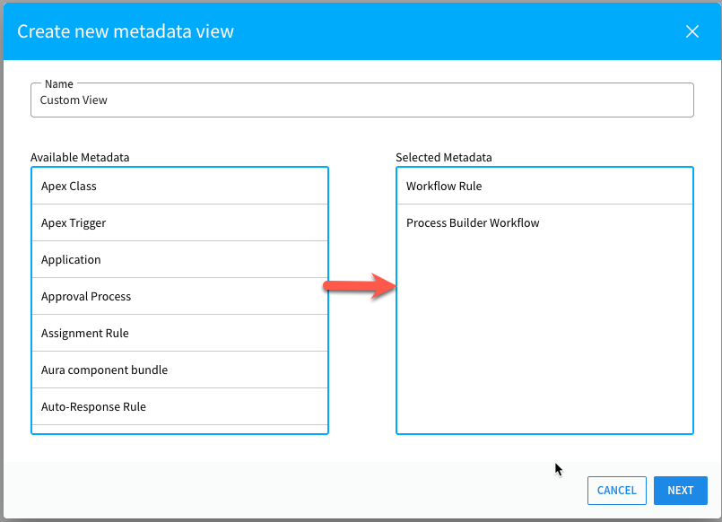
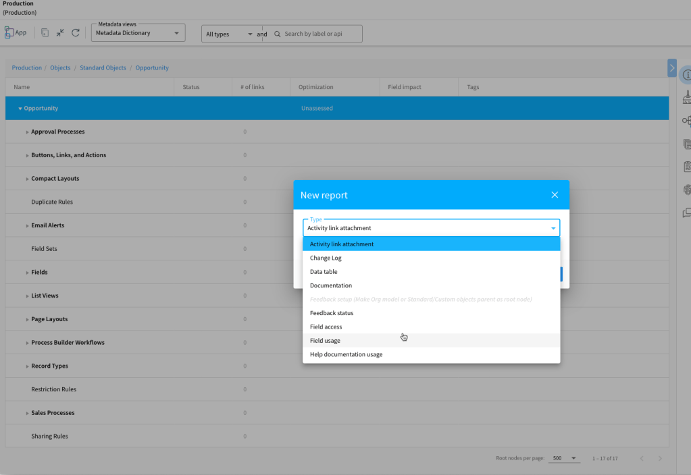
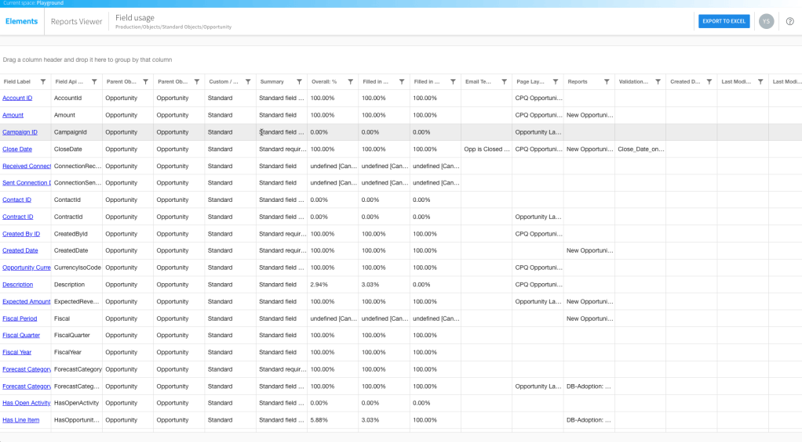

Technical debt is something that almost any long-standing company is going to end up with, particularly inside Salesforce. Usually, it is a combination of too many admins (or non-admins) in the system building and building while never cleaning up anything from the previous time. Sometimes, these new builds are band-aids on top of existing builds, and sometimes, old builds die out as the process is no longer used. Either way, you get left with a bit of a mess, and as time goes by, that mess can grow into problems that may affect your users.

The first steps in a tech debt project should be to run the Optimizer report and a health check. These will give you indications of the state of your org. You can also check out Salesforce's accelerators or do a QBR with your AE to provide additional context and information.

When running a tech debt project, you want to ensure that you have a clear focus for the project. It should be focused on cleaning up the metadata and not the data cleanup or governance of the fields. Doing the latter will result in a much larger project and may be too much to bite off. Two key topics in the metadata space are 1) converting process builders and _workflows_ to _flows_ (if you haven't already) and 2) migrating to Lightning Record Pages and away from Page Layouts.

While the ROI on this kind of project can be difficult, points to keep in mind are:

- Reduce the cost to build new items as you are working on a clean system post-update

- It will likely reduce the number of issues that the system is facing and users are reporting

- It will allow for easier maintenance

- Transformation projects will be easier to implement, as you will no longer have to worry about tech debt getting in the way.

To do this project, I would first recommend getting a tool like Elements.cloud (I have also recommended Snapshot in the past). Elements will allow you to run a complete system scan, finding which objects and fields may no longer be used. It can also provide reporting and analysis on the changes made to the system's metadata.

Let's review some functions in Elements that will help complete a tech debt project:

Dependency Trees: These views show all the dependencies in a tree or grid view of a specific node. Below are screenshots taken from the Account object node.  

<figure>

<figcaption>

Grid View

</figcaption>

</figure>

<figure>

<figcaption>

Tree View

</figcaption>

</figure>

  
Custom Metadata Views: This is a way to create a custom view within Elements. They do not have an export function, but you can copy and paste the whole table into Sheets and then work from there. I typically do all of the investigative or analysis work in Sheets, as I find the ability to pivot and filter very valuable.

  
First, click the Metadata Views from the menu bar to create a custom metadata view.

Next, you will get a pop-up, and you just need to follow the onscreen prompts. My example shows all active workflow rules and process builders in the system. Your fields and filters will vary based on your desired outcome.

Reports: You can run different reports in Elements to get details about the metadata broken out neatly into a table that can be exported to Excel.

  
Field data usage: This is my favorite report as it tells you how much a field is populated, whether it is custom or standard, and whether it has any dependencies. Typically, I take this out and [pivot](https://sf9to5.com/2019/04/30/profile-auditing-guide-excel-pivot-tables/) on the number of dependencies. Additionally, if you combine this with the Field Access report, you can get a deep understanding of how much has been populated and who has access to it. I have found that the percentage populated doesn't tell the [whole story](https://sf9to5.com/2019/06/10/declutter-fields-snapshot-metazoa/).

