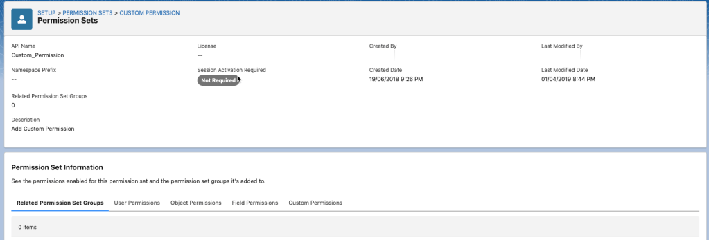

Initially announced in 2023, Salesforce said they would deprecate Profiles in Spring 2026. After much pushback from the community, Salesforce understood the system couldn't fully handle this change. They focus on improving the admin experience and migrating what is left of the controls from classic style to lightning style setup. However, with that being said, taking a jump on the actions required to eventually migrate fully from the Profile security structure will be of benefit when the time finally comes.

As Salesforce moves towards deprecating Profiles in favor of Permission Sets and Permission Set Groups, the way to consider the security model changes to a more modular one. The transition brings a more flexible security model that brings significant benefits. Still, it also requires admins and architects to rethink how they handle user access, page layouts, and Lightning adoption.

### The New Modular Security Model

Historically, Profiles have been the cornerstone of Salesforce’s security model, used to define access to objects, fields, and applications. However, Profiles have limitations in that they are mainly static and tied to a one-size-fits-all approach. At the same time, Permission Sets and Permission Set Groups can create a more dynamic and scalable way to manage permissions.

What about Permission Sets and Permission Set Groups is more modular?

- **Granularity**: Permission Sets allow for granular control over user permissions. Rather than assigning a Profile with broad access to multiple areas, you can tailor permissions based on specific needs. For example, instead of creating multiple profiles for slightly different roles, you can use a combination of reusable and adaptable permission sets.

- **Flexibility**: Permission Sets can be applied to users on top of their baseline Profile, enabling easy modification of access as business needs change. This minimizes the need for custom profiles.

- **Scalability**: Permission Set Groups enable bundling multiple Permission Sets, simplifying administration for larger teams. By grouping permissions for similar roles, you can assign a single group instead of multiple sets to each user, keeping security manageable as your org scales.

### The End of Page Layouts: Moving Fully to Lightning Record Pages

While Salesforce says in the article at the top of the post that Page Layouts are still a part of the Profile, it was initially written that their matrix between Profile, Page Layout, and Record Type would be going away. The post now only indicates that this will happen later by saying they will not put any future work into enabling Permission Sets to work with Page Layouts. As such, it will be essential to start considering the move to Lightning Record Pages and work on deprecating the classic Page Layouts.

The benefits of using Lightning Record Pages are:

- **Dynamic Page Layouts**: Unlike traditional Page Layouts, Lightning Record Pages are modular, offering dynamic visibility based on user criteria. You can configure different components to display based on user attributes like role, region, or even specific Permission Sets. This opens up the possibility for a more personalized user experience.

- **Flexibility in Design**: With Lightning App Builder, you have more control over the design of record pages. You can arrange components (such as [related lists](https://sf9to5.com/2019/06/18/related-lists-summer-19-updates/), charts, and custom components) optimally for your users. Unlike Page Layouts, you can easily modify these pages without needing to clone or recreate them entirely for minor updates.

- **Separation of Concerns**: Since Lightning Record Pages are no longer tied to Profiles, the layout and structure of a page can be dynamically managed without changing a user’s core permissions. This modular approach allows teams to create custom layouts for different business units without modifying the underlying security model.

### Planning for the Transition

Migrating to the [Permission Set first security model](https://admin.salesforce.com/blog/2023/how-to-build-a-permission-set-led-security-model) and [Lightning Record Pages](https://sf9to5.com/2021/11/30/difference-between-page-layouts-record-layouts-lightning-pages/) requires thoughtful planning, primarily in organizations that rely heavily on Profiles and Page Layouts. Here’s how to approach it:

1. Audit Your Profiles: Start by auditing all existing Profiles. Identify which permissions are assigned and break them down into modular Permission Sets. Some tools can assist with this process, including the [Profile to Permission set converter](https://help.salesforce.com/s/articleView?id=sf.perm_uapa_convert_profile_to_a_permission_set.htm&type=5) and the now GA function to see what is included in a Profile or Permission set.

1. **Group Permissions**: Use Permission Set Groups to bundle permissions logically. Think about your organization's roles and responsibilities and create group sets accordingly, simplifying the assignment process.

3. **Analyze Your Page Layouts**: Identify which Page Layouts are being used and which users they’re tied to. Consider how these can be translated into Lightning Record Pages with the use of dynamic visibility rules. Important caveats are to take stock of only Page Layouts in use and track which Record Types they are tied to. When you use Dynamic Forms, setting things up to mimic the impact of the Record Type might be necessary for your organization.

5. **Enable Dynamic Forms**: If you haven’t already, enable Dynamic Forms in Lightning. With Dynamic Forms, you can manage field visibility at the field level directly from Lightning App Builder. This is also what will enable you to fully deprecate the classic Page Layout.

7. **Pilot in a Sandbox**: Before fully migrating, test your new Permission Set structure and Lightning Record Pages in a sandbox. This ensures that access is correctly configured and that the user experience in Lightning is optimized. You will need to do this for every single team. Migration away from Profiles and Page Layouts may lead to unexpected results, so the testing step is critical.

9. **Communicate with Users**: Since Lightning Record Pages provide a different user experience than classic Page Layouts, you’ll need to communicate these changes to your users and provide training if needed.

### Final Thoughts

Salesforce’s deprecation of Profiles and Page Layouts marks a significant evolution toward a more modular and flexible security model. Organizations can better manage their security by adopting Permission Sets, Permission Set Groups, and Lightning Record Pages, reduce admin overhead, and deliver a more tailored user experience. The time to start planning for these changes is now—begin auditing your Profiles and layouts and embrace the full power of Salesforce’s Lightning platform.

\*\* Added in post edit due to updates by Salesforce - when migrating the page layouts, consider reviewing all existing fields. Salesforce now allows you to directly pull a field from a related object without creating a lookup or formula field. This could significantly reduce the number of fields in use, particularly for those companies who have had Salesforce a long time.

\*\* Written with the help of a custom ChatGPT\*\*
