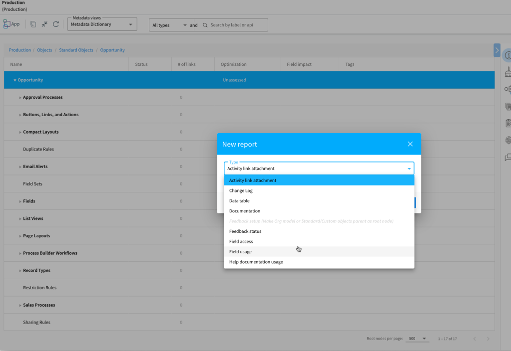
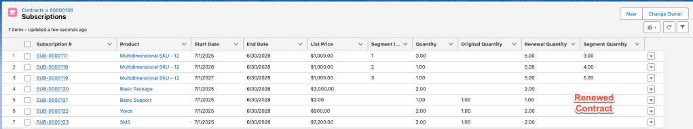

As mentioned in previous posts, MDQ is a special breed of product. Many functions that behave one way for a standard subscription product behave entirely differently on an MDQ or segmented product. One key field that falls into this category is the Quantity field. Below, I will work through the different quantity fields that need to be taken into account depending on what stage of the process you are in and what object you are looking at.

<figure>

<figcaption>

Initial Quote

</figcaption>

</figure>

The Quantity field behaves as expected on the initial quote; you can see this by comparing it to the Effective Quantity field.

<figure>

<figcaption>

Contract

</figcaption>

</figure>

Once on the Contract record and looking at the Subscription records, you will start to see some differences. The Quantity field here only works essentially for the first Segment. To see the value of the second and third segments, you need to review the Segment Quantity field. The reason is that the segments are ramping, and CPQ treats the quantity field to show the delta between the previous and the current line you are looking at. Also, you will note that the Renewal Quantity field is populated; this shows the amount the line value will renew to at the end of the term.

<figure>

<figcaption>

Renewal Quote before modifying

</figcaption>

</figure>

Prior to making any modifications to the Renewal Quote (which was auto-generated using the Renewal Quoted checkbox), you can see that we are back where we started, with both Quantity and Effective Quantity matching.

<figure>

<figcaption>

Renewal Quote after modifying

</figcaption>

</figure>

After making some modifications here, both on the segmented and non-segmented products, you can see a couple of things. First, the Original Quantity is only populated on the non-segmented products; this is just how Salesforce does things. However, this value allows you to compare Quantity or Effective Quantity to the Original Quantity (what the Renewal line came in as). You will also see that modifying the segmented product did not affect the Quantity or Effective Quantity behavior.

<figure>

<figcaption>

Renewed Contract

</figcaption>

</figure>

Lastly, on the renewed contract, you will see the same values noted on the previous contract.

In general, it is very important to remember the nuances of MDQ. The Salesforce help site has extensive documentation that discusses many functions.
